## Introduction

This tutorial will help you setup Docker with IPv6 in a secure way.

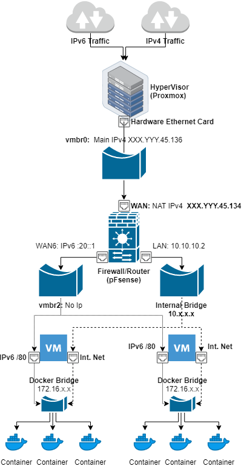

**Objectives**

* Automatic provisioning of IPv6
  * Each Docker container will receive an IPv6 automatically
* Routed IPv6 traffic between container in different Hosts
  * Each host will have a /80 that will be routed through pfSense
* Secured public access to our containers via IPv6
  * They will be reachable publicly so we want to be able to whitelist open ports in a secure way
* Out of band Firewall
  * Having an out of band firewall, meaning outside of the VM, will increase the security of the system

The tutorial was tested with *Proxmox VE 9*, *pfSense CE 2.9* and *Docker Engine 29*.

**Requirements**

1) IPv6 network

For this article, we will use a /64 IPv6 network because that is what many hosting providers give, and we will use the example 2001:db8:1234:321d::1/64. This will be divided in 4096 /76s:

* 2001:db8:1234:321d:10::1/76 WAN in Pfsense
* 2001:db8:1234:321d:20::1/76 VIP (or WAN6) gateway for VM1
  * 2001:db8:1234:321d:21::/80 for Docker containers in VM1
* 2001:db8:1234:321d:30::1/76 VIP gateway for VM2
  * 2001:db8:1234:321d:31::/80 for Docker containers in VM2
* 2001:db8:1234:321d:3e80::1/76 VMx
  * 2001:db8:1234:321d:3e81::/80 for Docker containers in VMx

This setup needs a **dedicated server**: the whole /64 is routed to a single MAC
address, so it has to land on a router that can split it up. A Cloud Server
gets a single address instead, so the IPv6 prefix cannot be subdivided in the
same way.

2) Hypervisor

We will need a way to provision VMs, for this article we selected Proxmox. More information on Proxmox can be found on their website: [Proxmox Virtual Environment](https://www.proxmox.com/en/proxmox-virtual-environment/get-started)

There is already a Tutorial on how to install Proxmox remotely on any server: [Install and Configure Proxmox VE](https://community.hetzner.com/tutorials/install-and-configure-proxmox_ve)

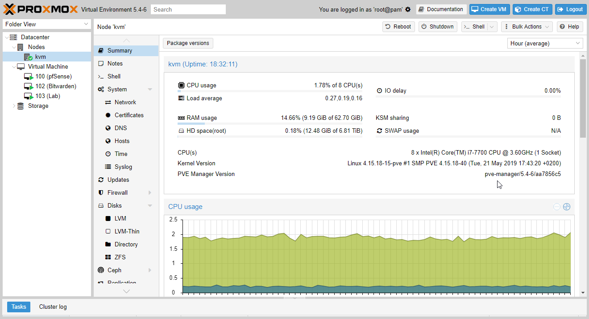

## Step 1 - Create Bridges

We will create 3 bridges:

* **vmbr0**: It will connect to the internet and receive both IPv4 and IPv6 traffic but will only have the main IPv4 assigned x.y.145.162/26
* **vmbr1**: The internal network shared between VMs, 10.10.10.1/24
* **vmbr2**: This bridge will hold the IPv6 network for our VMs, in this case a /64

In Proxmox 8 and later, bridges are managed in the web interface under
*Datacenter → Network*. The screenshot below shows the result on the host used
for this tutorial: `vmbr0` is the only bridge Proxmox creates by itself, the
other two were added manually.

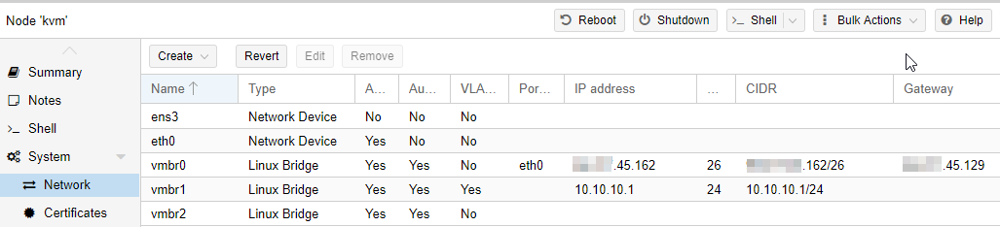

The resulting `/etc/network/interfaces` looks like this:

```ini
auto lo
iface lo inet loopback

iface eth0 inet manual

auto vmbr0
iface vmbr0 inet static
        address  x.y.145.162/26
        gateway  x.y.45.129
        bridge-ports eth0
        bridge-stp off
        bridge-fd 0

auto vmbr1
iface vmbr1 inet static
        address  10.10.10.1/24
        bridge-ports none
        bridge-stp off
        bridge-fd 0
        bridge-vlan-aware yes
        bridge-vids 2-4094

auto vmbr2
iface vmbr2 inet manual
        bridge-ports none
        bridge-stp off
        bridge-fd 0
```

Two things to watch out for here:

* Replace `eth0` with the name of your own network card. You can find it with
  `ip -br link`. Do not keep a stanza for a card that does not exist on your
  host: the bridge will not come up and the host ends up without a network.
* `vmbr2` deliberately has no address. It only exists to carry the IPv6
  traffic between the VMs and pfSense.

## Step 2 - Setup Firewall (pfSense)

We will need an out of band Firewall to be able to whitelist open ports and for this, we are going to use pfSense.

More information on using pfSense with Proxmox can be found in the [Netgate documentation](https://docs.netgate.com/pfsense/en/latest/recipes/virtualize-proxmox-ve.html).

We will add 3 network cards and configure each one to one of the Bridges we created before.

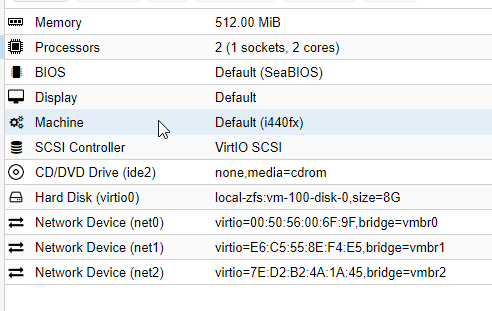

### Step 2.1 - Interface assignments

Assign the three virtual network cards to the interfaces of pfSense.

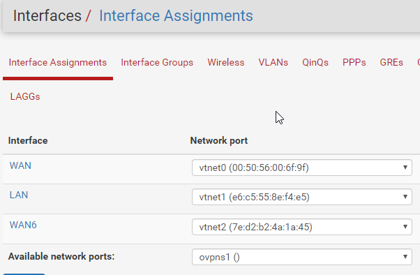

After assigning them, the interfaces show the addresses we are going to use.

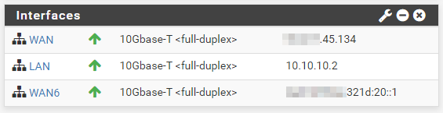

**IPv4**

* WAN NAT IPv4: x.y.145.134/26
* LAN: 10.10.10.2

**IPv6**

* WAN: 2001:db8:1234:321d:10::1/76
* WAN6: 2001:db8:1234:321d:20::1

We have 2 IPv4 assigned, one to access the Host KVM and the other to use as NAT and for the internal LAN. The NAT IPv4 is an additional address that Hetzner routes to the MAC address of the pfSense WAN interface (see Step 2.4).

The default gateway of the VM hosts is the VIP that pfSense answers on:

* VM1: 2001:db8:1234:321d:20::1
* VM2: 2001:db8:1234:321d:30::1
* VMx: 2001:db8:1234:321d:3e80::1

### Step 2.2 - Bridge WAN and WAN6

This step is the one that makes the rest work. Create a bridge that contains
both the WAN and the WAN6 interface.

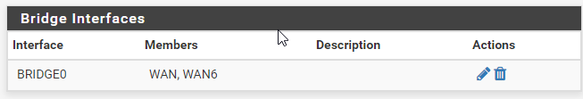

Both interfaces are attached to `vmbr0`, which is the bridge that has the
connection to the internet. Because they share the same layer 2 network,
pfSense can answer on the VIPs of every VM without the traffic taking an
asymmetric path, and the IPv6 prefix that Hetzner routes to the server reaches
pfSense through the very same interface.

### Step 2.3 - Routing

The default GW for IPv6 is fe80::1 through the WAN interface (not WAN6). This is because this interface is connected to the KVM bridge that has access to the connection to the internet.

Each Docker network in the VM host gets a static route so they can communicate between each other.
For this we need to define a Gateway as 2001:db8:1234:321d:20::2 through the WAN6 interface called "vm1" in the picture.

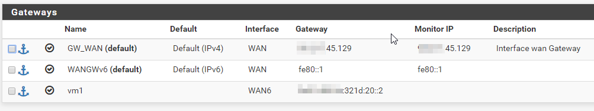

Finally we add a static route saying that our container subnet 21::/80 can be reached through the "vm1" gateway, that means through the interface WAN6 via the host at 20::2.

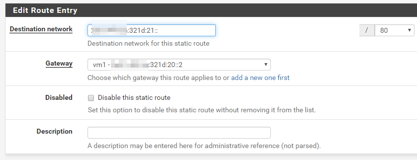

Repeat the static route for every VM that has containers, for example
2001:db8:1234:321d:31::/80 and 2001:db8:1234:321d:3e81::/80 for VM2 and VMx.

### Step 2.4 - MAC assignment for IPv6

Many hosters require that IPv6 traffic comes from the same MAC address associated with one of the IPv4. In this case it is the extra NAT IPv4.

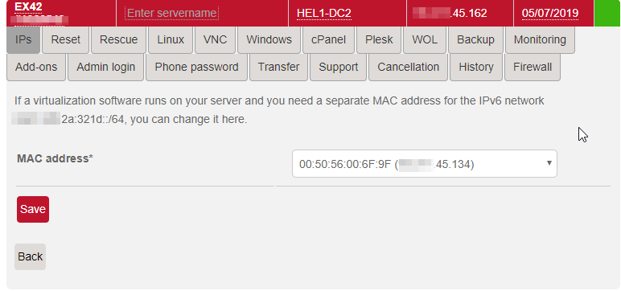

Select the MAC address of the additional IPv4 (the one that is used as the WAN
address of pfSense). Hetzner will then route the whole /64 to that MAC, which
means the prefix arrives at pfSense and can be split up there.

### Step 2.5 - Firewall Rules

We need to create the following firewall rules:

* **WAN (incoming):**
  * Allow ICMPv6 types 1 to 4 (destination unreachable, packet too big, time
    exceeded, parameter problem) to the container networks. Without them Path
    MTU Discovery silently breaks and connections stall on large transfers.
  * Allow the ports you want to publish, for example TCP 443 to
    2001:db8:1234:321d:21::/80
  * Deny everything else

* **WAN6 (incoming):**
  * Allow ICMPv6 to the VM uplinks (2001:db8:1234:321d:20::/76 and friends)
  * Deny everything else

* **Outgoing:**
  * From WAN6 to ANY (outgoing traffic)

The destination of the rules is the address of the **container**, not the
address of the Docker bridge. Docker does not translate the destination in
routed mode (see Step 4.2), so a request to 2001:db8:1234:321d:21:242:ac11:2
reaches pfSense with that very address as its destination.

> Remember that Docker has a firewall of its own. Rules in pfSense are not
> enough on their own, the traffic also has to pass the filter of the Docker
> host. Step 4.2 explains how to check it.

If you want a filter that is really out of band, the [Hetzner Robot firewall](https://docs.hetzner.com/robot/dedicated-server/firewall/)
is applied on the switch port of the server and therefore also covers the
traffic of the VMs. It filters IPv4 only by default, the IPv6 filter has to be
enabled with the *Filter IPv6 packets* option.

## Step 3 - VM configuration

The virtual network cards of the VM have to be attached to the right bridges.
In this example the VM has one card on `vmbr1` (internal) and one on `vmbr2`
(IPv6).

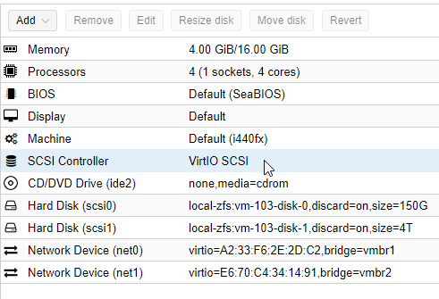

In this example we use systemd-networkd but the same idea can be used on any network manager. Basic information on systemd-networkd can be found in the [Hetzner documentation](https://docs.hetzner.com/robot/dedicated-server/network/network-configuration-using-systemd-networkd/).

Notice we use ::2 for our VM IPv6 and WAN6 interface IP as a default route.

```ini
[Match]
Name=eth1

[Network]
Address=2001:db8:1234:321d:20::2/76
Gateway=2001:db8:1234:321d:20::1
IPv6AcceptRA=no
```

`IPv6AcceptRA=no` is needed because the address is static. It also makes sure
that the kernel does not accept a Router Advertisement for the default route
and overwrite the gateway we just configured.

This will give us:

```bash
# ip -6 addr show dev eth1
3: eth1: <BROADCAST,MULTICAST,UP,LOWER_UP> mtu 1500 qdisc fq_codel master docker0 state UP group default qlen 1000
    inet6 2001:db8:1234:321d:20::2/76 scope global
       valid_lft forever preferred_lft forever
    inet6 fe80::e470:c4ff:fe34:1491/64 scope link
       valid_lft forever preferred_lft forever
```

Test we have IPv6 connectivity:

```bash
# ping -6 www.google.com
PING www.google.com(ams16s29-in-x04.1e100.net (2a00:1450:400e:804::2004)) 56 data bytes
64 bytes from ams16s29-in-x04.1e100.net (2a00:1450:400e:804::2004): icmp_seq=1 ttl=55 time=32.2 ms
64 bytes from ams16s29-in-x04.1e100.net (2a00:1450:400e:804::2004): icmp_seq=2 ttl=55 time=32.5 ms
64 bytes from ams16s29-in-x04.1e100.net (2a00:1450:400e:804::2004): icmp_seq=3 ttl=55 time=32.4 ms
```

## Step 4 - Docker configuration

Basic information on configuring a routed Docker environment with IPv6 can be found in the [Docker documentation](https://docs.docker.com/engine/daemon/ipv6/).

We configure docker to use our /80 subnets under 21::/80.

```json
{
  "ipv6": true,
  "ip6tables": true,
  "allow-direct-routing": true,
  "fixed-cidr-v6": "2001:db8:1234:321d:21::/80"
}
```

* `ipv6` enables IPv6 on the default bridge network.
* `ip6tables` makes Docker manage the IPv6 packet filter. It is enabled by
  default since Docker 27. Before that, the IPv6 traffic of the containers was
  not part of the rules of the Docker host at all.
* `allow-direct-routing` is **required since Docker 28.2**. See Step 4.2.
* `fixed-cidr-v6` assigns the subnet to the default bridge network. It only
  applies to the default bridge, user defined networks need `--ipv6 --subnet`.

Restart the daemon for the changes to take effect:

```bash
# systemctl restart docker
```

Test it by using an alpine container:

```bash
# docker run -it alpine ash
/ # ip -6 route
2001:db8:1234:321d:21::/80 dev eth0  metric 256
fe80::/64 dev eth0  metric 256
default via 2001:db8:1234:321d:21::1 dev eth0  metric 1024
ff00::/8 dev eth0  metric 256

/ # ip -6 addr
1: lo: <LOOPBACK,UP,LOWER_UP> mtu 65536 state UNKNOWN qlen 1000
    inet6 ::1/128 scope host
       valid_lft forever preferred_lft forever
43: eth0@if44: <BROADCAST,MULTICAST,UP,LOWER_UP,M-DOWN> mtu 1500 state UP
    inet6 2001:db8:1234:321d:21:242:ac11:2/80 scope global flags 02
       valid_lft forever preferred_lft forever
    inet6 fe80::42:acff:fe11:2/64 scope link
       valid_lft forever preferred_lft forever

/ # ping -6 www.google.com
PING www.google.com (2a00:1450:400e:807::2004): 56 data bytes
64 bytes from 2a00:1450:400e:807::2004: seq=0 ttl=55 time=26.828 ms
64 bytes from 2a00:1450:400e:807::2004: seq=1 ttl=55 time=26.904 ms
```

From here we can see we got 2001:db8:1234:321d:21:242:ac11:2/80 and ping to google works.

### Step 4.1 - Publish the ports

The container now has a public IPv6, but that alone does not make it
reachable. The port has to be published, and the published port is the one
that the firewall rules of Step 2.5 refer to.

```bash
# docker run -d --name web -p 443:443 nginx
```

The container is now reachable on its own address, for example
`https://2001:db8:1234:321d:21:242:ac11:2/`.

### Step 4.2 - Allow direct access to the containers

Since Docker 28.2, the bridge driver drops every packet that is addressed
directly to a container and does not come from the bridge itself. The rule
lives in the `raw` table and is applied before the routing decision:

```bash
# ip6tables -t raw -L PREROUTING -n -v --line-numbers
```

Without the `allow-direct-routing` option of Step 4, the packets that pfSense
forwards never reach the container: they are dropped by the Docker host
itself. There are three ways to deal with it:

* `allow-direct-routing` in `/etc/docker/daemon.json` allows direct access to
  the published ports of every container. This is what the configuration above
  uses.
* A user defined network in *routed* mode is not filtered at all. This is the
  recommended setup, because it also gives you a network you can attach
  containers to by name and control on a per network basis:

  ```bash
  # docker network create --ipv6 --subnet 2001:db8:1234:321d:22::/80 \
  #   -o com.docker.network.bridge.gateway_mode_ipv6=routed docker-ipv6
  # docker run -d --network docker-ipv6 -p 443:443 nginx
  ```

  In routed mode no NAT or masquerading rules are set up, and the published
  port is reachable directly on the address of the container. Remember to add
  the matching static route for 2001:db8:1234:321d:22::/80 in pfSense.
* `com.docker.network.bridge.trusted_host_interfaces` allows direct access
  from specific interfaces of the host only, for example `eth1`.

The default bridge cannot be put into routed mode, so if you use it, the first
option is the one you need.

> **IPv6 forwarding:** Docker enables `net.ipv6.conf.all.forwarding=1` on the
> host. A kernel that has forwarding enabled ignores Router Advertisements
> unless `net.ipv6.conf.all.accept_ra=2` is set. If the address of the host
> comes from SLAAC, set it explicitly.

### Step 4.3 - Static IP

Ideally we would want to have static IPv6 for some of the Docker containers that run some kind of server. This can be achieved by passing the correct arguments at the time of creation.

`--ip6` only works on a user defined network that was created with a subnet,
so create the network first:

```bash
# docker network create --ipv6 --subnet 2001:db8:1234:321d:22::/80 \
#   -o com.docker.network.bridge.gateway_mode_ipv6=routed docker-ipv6
```

And then assign the address to the container:

```bash
# docker run -d --network docker-ipv6 --ip6 2001:db8:1234:321d:22::1234 -p 443:443 nginx
```

## Conclusion

If you have followed this tutorial, then every Docker container that you create will have an IPv6 provisioned automatically that can be accessed from the public internet, and you can control which ports are accessible through an out of band firewall (pfSense).

**Next steps:**

* [Install Docker CE on Debian with Dual stack and Firewall Support](https://community.hetzner.com/tutorials/debian-docker-install-dualstack-firewall) if you also need IPv4 port forwarding
* [Distributing IPv6 over libvirt guests](https://community.hetzner.com/tutorials/distributing-ipv6-over-libvirt-guests) for a different way of handing an IPv6 prefix to a guest

### License: MIT

<!--

Contributors's Certificate of Origin

By making a contribution to this project, I certify that:

(a) The contribution was created in whole or in part by me and I have
    the right to submit it under the license indicated in the file; or

(b) The contribution is based upon previous work that, to the best of my
    knowledge, is covered under an appropriate license and I have the
    right under that license to submit that work with modifications,
    whether created in whole or in part by me, under the same license
    (unless I am permitted to submit under a different license), as
    indicated in the file; or

(c) The contribution was provided directly to me by some other person
    who certified (a), (b) or (c) and I have not modified it.

(d) I understand and agree that this project and the contribution are
    public and that a record of the contribution (including all personal
    information I submit with it, including my sign-off) is maintained
    indefinitely and may be redistributed consistent with this project
    or the license(s) involved.

Signed-off-by: [Rodrigo A. Diaz Leven ramakandra@gmail.com]

-->
