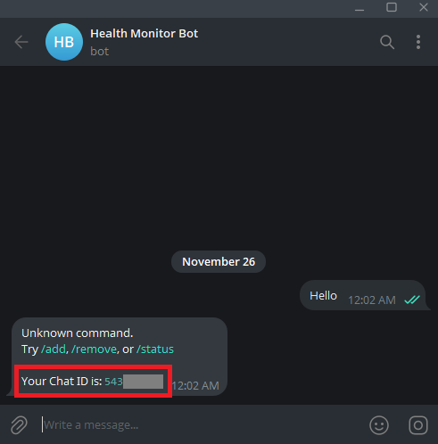

## Introduction

Self-hosted services tend to fail silently. A reverse proxy, a database, or a container goes down and nobody notices until a user complains. Telegram is one of the fastest ways to reach you when something breaks.

In this tutorial, you will build a **Health Monitor Bot** with [**Go**][golang_home] lang using the zero-dependency [`go-telegram/bot`][github_go_tg_bot] framework. It periodically checks HTTP endpoints, alerts you when a service goes down or recovers, and lets you inspect the curent state with a `/status` command.

##### Why using Docker?

[**Go**][golang_home] will generate us a single static binary, but [Docker][docker_home] gives you three important benefits for a monitoring tool:

- **Restart on failure:** `--restart unless-stopped` keeps the monitor alive even after a server reboot.
- **Isolation:** The bot runs in its own sandbox with minimal or zero dependencies.
- **Reproducibility:** Rebuild the image and redeploy on any host, with no Go toolchain required at runtime.

**Prerequisites**

- Basic knowledge of Go, including functions, structs, and goroutines.
- A Linux server with Docker installed (for example, a [Hetzner Cloud][hetzner_cloud] server running [Rocky Linux][rockylinux_home]).
- A Telegram bot token from [@BotFather][bot_father].
- Go 1.27+ installed locally to build the binary before containerizing it.

**Example terminology**

- Bot token: `3456789:xxxxxxx`
- Container name: `health-monitor`
- Monitored endpoints: any HTTP(S) URL reachable from your server.

## Step 1 - Initialize the Project

Talk to [@BotFather][bot_father], send `/newbot`, and copy the token. It will be passed to the container via a environment variable.

Create the project and install the framework:

```sh
cd ~
mkdir health-monitor-bot
cd health-monitor-bot

go mod init main

go get github.com/go-telegram/bot
go get modernc.org/sqlite
```

Project layout:

```txt
health-monitor-bot/
├─ go.mod
├─ go.sum
├─ main.go
├─ storage.go
└─ Dockerfile
```

## Step 2 - Store State in SQLite

Create `storage.go` file. It uses [`modernc.org/sqlite`][github_modernc], a pure-Go driver that requires no CGO (C compiler) and keeps the Docker build simple.

```go
package main

import (
	"database/sql"

	_ "modernc.org/sqlite"
)

type Endpoint struct {
	ID       int64
	Name     string
	URL      string
	Healthy  bool
	LastCode int
}

type Storage struct{ db *sql.DB }

func NewStorage(path string) (*Storage, error) {
	db, err := sql.Open("sqlite", path)
	if err != nil {
		return nil, err
	}

	_, err = db.Exec(`
		CREATE TABLE IF NOT EXISTS endpoints (
			id        INTEGER PRIMARY KEY AUTOINCREMENT,
			name      TEXT    NOT NULL UNIQUE,
			url       TEXT    NOT NULL,
			healthy   INTEGER NOT NULL DEFAULT 1,
			last_code INTEGER NOT NULL DEFAULT 0
		);
	`)

	return &Storage{db: db}, err
}

func (s *Storage) Add(name, url string) error {
	_, err := s.db.Exec(`
		INSERT INTO endpoints (name, url)
		VALUES (?, ?)`,
		name, url,
	)

	return err
}

func (s *Storage) Remove(name string) (bool, error) {
	res, err := s.db.Exec(`DELETE FROM endpoints WHERE name = ?`, name)
	if err != nil {
		return false, err
	}

	n, _ := res.RowsAffected()
	return n > 0, nil
}

func (s *Storage) All() ([]Endpoint, error) {
	rows, err := s.db.Query(`
		SELECT id, name, url, healthy, last_code
		FROM endpoints
		ORDER BY name
	`)
	if err != nil {
		return nil, err
	}

	defer rows.Close()

	var out []Endpoint
	for rows.Next() {
		var e Endpoint
		err := rows.Scan(&e.ID, &e.Name, &e.URL, &e.Healthy, &e.LastCode)
		if err != nil {
			return nil, err
		}
		out = append(out, e)
	}

	return out, rows.Err()
}

func (s *Storage) UpdateState(id int64, healthy bool, code int) error {
	_, err := s.db.Exec(`
		UPDATE endpoints
		SET healthy = ?, last_code = ?
		WHERE id = ?`,
		healthy, code, id,
	)
	return err
}
```

## Step 3 - Commands and Health Checks

Create `main.go` file. The bot registers three commands (`/add`, `/remove`, `/status`) and runs a background loop that probes every endpoint once per minute. It only sends a message when an endpoint **changes state**, so you are not spammed every cycle.

```go
package main

import (
	"context"
	"fmt"
	"log"
	"net/http"
	"os"
	"os/signal"
	"strings"
	"time"

	"github.com/go-telegram/bot"
	"github.com/go-telegram/bot/models"
)

type App struct {
	store  *Storage     // SQLite persistence for endpoints
	tg     *bot.Bot     // Telegram client used to send messages
	chatID int64        // chat that receives alerts
	client *http.Client // HTTP client with a timeout for health probes
}

func main() {
	ctx, cancel := signal.NotifyContext(context.Background(), os.Interrupt)
	defer cancel()

	// Load the bot token and target chat ID from environment variables.
	token := os.Getenv("TELEGRAM_BOT_TOKEN")
	chatIDStr := os.Getenv("TELEGRAM_CHAT_ID")
	if token == "" || chatIDStr == "" {
		log.Fatal("TELEGRAM_BOT_TOKEN and TELEGRAM_CHAT_ID must be set")
	}

	// Convert the chat ID string into an int64.
	var chatID int64
	fmt.Sscan(chatIDStr, &chatID)

	dbPath := os.Getenv("DB_PATH")
	if dbPath == "" {
		dbPath = "/data/health.db"
	}

	// Open the SQLite database, creating it and its tables if needed.
	store, err := NewStorage(dbPath)
	if err != nil {
		log.Fatalf("storage: %v", err)
	}

	// Default reply message.
	var defaultHandler bot.Option = bot.WithDefaultHandler(func(ctx context.Context, b *bot.Bot, u *models.Update) {
		if u.Message == nil {
			return
		}
		text := fmt.Sprintf(
			"Unknown command.\nTry /add, /remove, or /status\n\nYour Chat ID is: `%d`",
			u.Message.Chat.ID,
		)
		b.SendMessage(ctx, &bot.SendMessageParams{
			ChatID:    u.Message.Chat.ID,
			Text:      text,
			ParseMode: "Markdown",
		})
	})

	// Create the Telegram bot client using the token.
	b, err := bot.New(token, defaultHandler)
	if err != nil {
		log.Fatalf("bot: %v", err)
	}

	app := &App{
		store:  store,
		tg:     b,
		chatID: chatID,
		client: &http.Client{Timeout: 5 * time.Second},
	}

	b.RegisterHandler(bot.HandlerTypeMessageText, "/add", bot.MatchTypePrefix, app.handleAdd, app.ownerOnly)
	b.RegisterHandler(bot.HandlerTypeMessageText, "/remove", bot.MatchTypePrefix, app.handleRemove, app.ownerOnly)
	b.RegisterHandler(bot.HandlerTypeMessageText, "/status", bot.MatchTypeExact, app.handleStatus, app.ownerOnly)

	go app.monitor(ctx)
	b.Start(ctx)
}

// This middleware wraps a handler so only the owner can send commands.
func (a *App) ownerOnly(h bot.HandlerFunc) bot.HandlerFunc {
	return func(ctx context.Context, b *bot.Bot, u *models.Update) {
		if u.Message == nil || u.Message.From == nil {
			return
		}
		if u.Message.From.ID != a.chatID {
			b.SendMessage(ctx, &bot.SendMessageParams{
				ChatID: u.Message.Chat.ID,
				Text:   "📍 Unauthorized.",
			})
			return
		}
		h(ctx, b, u)
	}
}

func (a *App) handleAdd(ctx context.Context, b *bot.Bot, u *models.Update) {
	// Usage: /add <name> <url>
	parts := strings.Fields(u.Message.Text)
	if len(parts) != 3 {
		a.reply(ctx, "Usage: `/add <name> <url>`")
		return
	}

	// Persist the new endpoint, report any database error to the user.
	err := a.store.Add(parts[1], parts[2])
	if err != nil {
		a.reply(ctx, "Could not add endpoint: "+err.Error())
		return
	}

	a.reply(ctx, fmt.Sprintf("Monitoring *%s*", parts[1]))
}

func (a *App) handleRemove(ctx context.Context, b *bot.Bot, u *models.Update) {
	parts := strings.Fields(u.Message.Text)
	if len(parts) != 2 {
		a.reply(ctx, "Usage: `/remove <name>`")
		return
	}

	ok, err := a.store.Remove(parts[1])
	if err != nil || !ok {
		a.reply(ctx, "Endpoint not found.")
		return
	}

	a.reply(ctx, fmt.Sprintf("Removed *%s*", parts[1]))
}

func (a *App) handleStatus(ctx context.Context, b *bot.Bot, u *models.Update) {
	eps, err := a.store.All()
	if err != nil || len(eps) == 0 {
		a.reply(ctx, "No endpoints monitored yet.\nUse `/add <name> <url>`")
		return
	}

	var sb strings.Builder
	sb.WriteString("*Service status*\n\n")

	for _, e := range eps {
		icon := ""
		if !e.Healthy {
			icon = "📍 "
		}
		fmt.Fprintf(
			&sb,
			"%s`%s` - HTTP %d\n",
			icon, e.Name, e.LastCode,
		)
	}

	a.reply(ctx, sb.String())
}

func (a *App) reply(ctx context.Context, text string) {
	// Send the message to the configured chat with Markdown format.
	_, err := a.tg.SendMessage(ctx, &bot.SendMessageParams{
		ChatID:    a.chatID,
		Text:      text,
		ParseMode: "Markdown",
	})
	if err != nil {
		log.Printf("send message to chat %d failed: %v", a.chatID, err)
	}
}

// The health checks in a loop,
// once per minute, until the context is cancelled.
func (a *App) monitor(ctx context.Context) {
	ticker := time.NewTicker(time.Minute)
	defer ticker.Stop()

	for {
		a.checkAll(ctx)
		select {
		case <-ctx.Done():
			return
		case <-ticker.C:
		}
	}
}

func (a *App) checkAll(ctx context.Context) {
	eps, err := a.store.All()
	if err != nil {
		log.Printf("list endpoints: %v", err)
		return
	}

	for _, e := range eps {
		code, ok := a.probe(ctx, e.URL)
		if ok == e.Healthy && code == e.LastCode {
			continue
		}

		err := a.store.UpdateState(e.ID, ok, code)
		if err != nil {
			log.Printf("update state: %v", err)
			continue
		}

		// Only alert on transitions from healthy to unhealthy and vice versa.
		if ok != e.Healthy {
			icon := "📍 DOWN"
			if ok {
				icon = "RECOVERED"
			}
			a.reply(
				ctx,
				fmt.Sprintf(
					"%s: *%s* (%s) - HTTP %d",
					icon, e.Name, e.URL, code,
				),
			)
		}
	}
}

// Sends a GET request to the given URL and returns the HTTP
// status code and whether it is healthy (2xx or 3xx).
func (a *App) probe(ctx context.Context, url string) (int, bool) {
	req, err := http.NewRequestWithContext(ctx, http.MethodGet, url, nil)
	if err != nil {
		return 0, false
	}

	resp, err := a.client.Do(req)
	if err != nil {
		return 0, false
	}
	defer resp.Body.Close()

	return resp.StatusCode, resp.StatusCode >= 200 && resp.StatusCode < 400
}
```

**Notes**

- The bot uses long polling (default for [`go-telegram/bot`][github_go_tg_bot]), so no public HTTP endpoint is required.
- Alerts fire **only on state changes**, so a service that stays down does not flood the chat.
- `TELEGRAM_CHAT_ID` pins alerts to a single chat. To find your chat ID, send any message to the bot and you will see a reply that contains your ID.



## Step 4 - Write the Dockerfile

The binary is fully static, so this stage can be minimal:

```dockerfile
FROM golang:1.27-alpine AS builder
WORKDIR /src
RUN apk add --no-cache ca-certificates
COPY go.mod go.sum ./
RUN go mod download
COPY . .
RUN CGO_ENABLED=0 go build -ldflags="-s" -o /out/health-monitor .

FROM alpine:3.24
RUN apk add --no-cache ca-certificates tzdata
COPY --from=builder /out/health-monitor /usr/local/bin/health-monitor
RUN mkdir -p /data
ENV DB_PATH=/data/health.db
ENTRYPOINT ["/usr/local/bin/health-monitor"]
```

## Step 5 - Install Docker

I wrote another tutorial on the Hetzner Community that helps you install Docker: [Install Docker on Rocky Linux][docker_install].

After installing, verify Docker works:

```sh
docker --version
docker run --rm hello-world
```

## Step 6 - Build and Run the Container

Build the image:

```sh
cd ~/health-monitor-bot
docker build -t health-monitor .

# Start the container.
#
# 1. -e: passes environment variables into the container (token, chat ID, timezone).
# 2. TZ: sets the container timezone so checks and timestamps match your local time.
# 3. -v: mounts a named volume so the SQLite database survives restarts.
#
docker run -d \
	--name health-monitor \
	--restart unless-stopped \
	-e TELEGRAM_BOT_TOKEN="333:xxxxxxx" \
	-e TELEGRAM_CHAT_ID="your-chat-id" \
	-e TZ="UTC" \
	-v health-data:/data \
	health-monitor

# Tail the logs to confirm it started.
docker logs -f health-monitor
```

## Step 6 - Test the Bot

Open up the Telegram app and send the following commands one by one in the chat with your bot:

```txt
/add hetzner_database https://db.example.com/admin
/add hetzner_vps https://vps.example.com/status
/status
```

You should see a status report. To test alerting, temporarily stop one of the monitored services, then wait up to one minute. The bot will send:

```txt
📍 DOWN: hetzner_vps (https://vps.example.com/status) — HTTP xxx
```

When the service comes back, you will receive the corresponding **RECOVERED** message.

## Step 7 - Update and Manage the Container

Because state lives on the `health-data` volume, you can safely rebuild and redeploy:

```sh
docker stop health-monitor && docker rm health-monitor
docker build -t health-monitor .

docker run -d \
	--name health-monitor \
	--restart unless-stopped \
	-e TELEGRAM_BOT_TOKEN="333:xxxxxxx" \
	-e TELEGRAM_CHAT_ID="your-chat-id" \
	-e TZ="UTC" \
	-v health-data:/data \
	health-monitor
```

To inspect and test the database from the host:

```sh
# 1. --rm : removes the temporary container after it exits (no leftovers).
# 2. -it  : runs it interactively so you see the command output.
# 3. -v   : mounts the same named volume so SQLite reads the bot's actual database.
# 4. sh -c: runs the quoted command string inside the container's shell.
#
docker run --rm -it \
	-v health-data:/data \
	alpine:3.24 \
	sh -c "apk add --no-cache sqlite && sqlite3 /data/health.db 'SELECT * FROM endpoints;'"
```

## Conclusion

And now, you have a small, self-contained **Health Monitor Bot** that runs in Docker, alerts you through Telegram on state changes, and can be redeployed in seconds. From here you can:

- Add a `/mute <name>` command to silence alerts for planned maintenance.
- Include response time in the alert message to catch slow endpoints.

[docker_home]: https://www.docker.com/
[docker_install]: https://community.hetzner.com/tutorials/discord-dockerizing-a-bot-on-rocky-linux/#step-2---install-docker-on-rocky-linux
[github_go_tg_bot]: https://github.com/go-telegram/bot
[github_modernc]: https://github.com/modernc-org/sqlite
[golang_home]: https://go.dev/
[hetzner_cloud]: https://www.hetzner.com/cloud/
[rockylinux_home]: https://rockylinux.org/
[bot_father]: https://t.me/BotFather
[bot_userinfo]: https://t.me/userinfobot

##### License: MIT

<!--

Contributor's Certificate of Origin

By making a contribution to this project, I certify that:

(a) The contribution was created in whole or in part by me and I have
    the right to submit it under the license indicated in the file; or

(b) The contribution is based upon previous work that, to the best of my
    knowledge, is covered under an appropriate license and I have the
    right under that license to submit that work with modifications,
    whether created in whole or in part by me, under the same license
    (unless I am permitted to submit under a different license), as
    indicated in the file; or

(c) The contribution was provided directly to me by some other person
    who certified (a), (b) or (c) and I have not modified it.

(d) I understand and agree that this project and the contribution are
    public and that a record of the contribution (including all personal
    information I submit with it, including my sign-off) is maintained
    indefinitely and may be redistributed consistent with this project
    or the license(s) involved.

Signed-off-by: Nik oqabemail@gmail.com

-->
