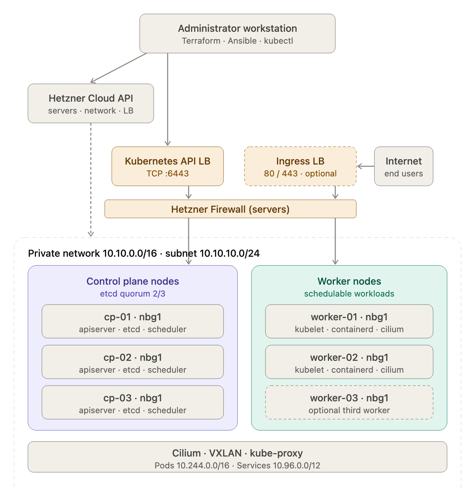

## Introduction

I teach Kubernetes the slow way. Before anyone gets near a managed control plane, they build one with kubeadm: three control planes, two workers, a load balancer in front of the API, and a private network underneath. It takes an afternoon. By the end, etcd quorum, bootstrap tokens, and the difference between the Pod network and the Service network have stopped being diagrams on a slide.

This article is the written version of that exercise on Hetzner Cloud. I use Hetzner for it because the platform gives you the pieces a kubeadm cluster actually needs (servers, a private network, a TCP load balancer, a firewall) without wrapping them in an installer. You will create the infrastructure with Terraform, configure Ubuntu with Ansible, install containerd and the Kubernetes packages, bootstrap the control plane, join two workers, install Cilium, and check the result.

Every file is in the article. There is no repository to clone, and that is on purpose: copying a working repository teaches you very little about why the pieces fit. Type the files, read the comments, break something, fix it. That is the exercise.

### What you are building

Five servers in one Hetzner project, all on the same private network:

| Host | Role | Type | Private address |
| --- | --- | --- | --- |
| `cp-01` | control plane, etcd | `cx23` | `10.10.10.11` |
| `cp-02` | control plane, etcd | `cx23` | `10.10.10.12` |
| `cp-03` | control plane, etcd | `cx23` | `10.10.10.13` |
| `worker-01` | worker | `cx33` | `10.10.10.21` |
| `worker-02` | worker | `cx33` | `10.10.10.22` |

Three control planes is not a vanity metric. etcd needs a majority to accept writes; with three members you can lose one and keep going, with two you cannot lose either. The two workers are enough to schedule a workload on one node and watch it move to the other, which is the part of the exercise that makes scheduling tangible. Add a third worker if you want to drain a node without reducing capacity.

The diagram below is the one I use to frame the lab. The dashed blocks are optional: the third worker and the ingress path. The Terraform in this article creates two workers and the API load balancer only.



> **The Ingress LB and Internet blocks are optional.** This tutorial builds the API path only: the private network, the API load balancer, and the five nodes. The dashed ingress load balancer and the Internet block beside it show where a maintained ingress controller would sit if you expose workloads later. ingress-nginx was retired in March 2026, so do not rebuild the old path; use a maintained controller or Gateway API, add a second Hetzner load balancer for ports 80 and 443, and handle DNS and TLS separately.

The address in every kubeconfig is the load balancer's public IPv4. That is deliberate: kubeadm writes the control-plane endpoint into kubeconfigs and join commands, and if that endpoint were `cp-01`, losing `cp-01` would also mean losing the ability to join a replacement node.

A few other decisions are worth stating before you copy a single file.

The load balancer is a TCP passthrough on port 6443. The API server terminates TLS itself; a layer 7 balancer would only add a place for tokens to be inspected and misconfigured.

The private network carries etcd peer traffic, kubelet-to-API traffic, and Pod traffic. The public IPv4 addresses exist for SSH and outbound package downloads. They are not the cluster's backbone.

Cilium runs with Kubernetes IPAM, VXLAN, and kube-proxy still installed. You can run Cilium in kube-proxy replacement mode; I don't, because I want students to see the kube-proxy DaemonSet and the iptables rules it leaves behind. That is a teaching choice, not a performance claim.

This tutorial stops at the API; it does not deploy an ingress controller. Adding an ingress layer would double the length of the article without teaching anything about the control plane, and the optional path in the diagram is where that work would start. Expose workloads however you like after the cluster is up.

### Cost, quotas, and the thing you should not forget

Five servers and a load balancer bill by the hour. In class we destroy the project at the end of the day, and I suggest you do the same: finish the verification, take your notes, then run the destroy step at the end of this article. Don't leave the cluster running while you read the next section on a train.

New Hetzner projects sometimes start with a low server quota. You need room for five servers, one load balancer, one network, one subnet, and one firewall. If the plan fails with a quota error, request an increase in the Console and try again; nothing in the configuration is wrong.

### Versions used here

| Component | Version | Why it is pinned |
| --- | --- | --- |
| Ubuntu | 24.04 | Hetzner image used in the lab |
| Terraform | 1.17.0 (configuration accepts `>= 1.5.7`) | CLI version in the lab |
| `hcloud` provider | 1.68.0 | Exact provider build |
| `local` provider | 2.9.1 | Writes the Ansible inventory |
| Kubernetes | 1.36.4 | Patch release in the 1.36 line |
| containerd | 2.2.1 | Upstream tarball, systemd cgroups |
| runc | 1.3.4 | Runtime version used with containerd 2.2.1 |
| Cilium | 1.20.1 | Agent version installed by the CLI |
| Cilium CLI | 0.19.7 | Used for install and status |

Pinning is not nostalgia. The Kubernetes apt repositories keep patches for supported minors only, container runtime packaging moves, and a tutorial that says "install the latest" breaks quietly six months later. Change the numbers in the version variables and the two Terraform files when you move to a newer baseline.

### Prerequisites

You need a Hetzner Cloud project, a read/write API token for that project, and your current public IPv4 address. The token is created in the Console under the project's security settings. The address is what the firewall will allow for SSH; if you are on a connection that rotates addresses, expect to update the firewall before you can reconnect.

On your workstation you need Terraform, Ansible, `kubectl`, `curl`, and OpenSSH. The versions in the table above are what the lab used, but any Terraform 1.5.7 or later and a recent Ansible release will work. You don't need Helm, a domain name, or a local Kubernetes cluster.

One last warning. This is a training cluster, not a production design. It has no etcd backups, no audit logging, no private API endpoint, and it logs in as `root` because that is one less variable when five students are typing at once. I say more about that at the end.

## Step 1: Workstation, SSH key, and project skeleton

Create a dedicated key pair. Don't reuse your personal key: this one will be registered in a cloud project, and you may want to delete it when the lab is over.

```bash
ssh-keygen -t ed25519 -a 100 \
  -f "$HOME/.ssh/kubeadm-hetzner-lab" \
  -C "kubeadm-hetzner-lab"
chmod 600 "$HOME/.ssh/kubeadm-hetzner-lab"
chmod 644 "$HOME/.ssh/kubeadm-hetzner-lab.pub"
```

The `-a 100` option makes a passphrase guess slower, which is worth the few extra milliseconds every time you unlock the key. Use a passphrase. If you add the key to your SSH agent for the session, Ansible will not ask for it on every task:

```bash
eval "$(ssh-agent -s)"
ssh-add "$HOME/.ssh/kubeadm-hetzner-lab"
```

Terraform will read the public key at `~/.ssh/kubeadm-hetzner-lab.pub` and register it with Hetzner. The private half never leaves your machine, and it should never appear in a Terraform variable, a repository, or a chat window.

Create the project directory. The layout below is the one Ansible expects; if you rename a folder, change `ansible.cfg` and the role paths to match.

```bash
mkdir -p kubeadm-hetzner-lab/{terraform/templates,ansible/inventory/group_vars,ansible/playbooks,kubeconfig}
cd kubeadm-hetzner-lab
mkdir -p ansible/roles/{cilium/tasks,common/{tasks,handlers},containerd/{defaults,handlers,tasks},control_plane/{tasks,templates},hetzner-network/{defaults,tasks,templates},kubernetes/tasks}
```

Then add a `.gitignore` before you create anything worth leaking. Terraform state, plans, the private variable file, the generated inventory, and the kubeconfig all contain addresses or secrets.

```bash
cat > .gitignore <<'EOF'
.terraform/
*.tfstate
*.tfstate.*
terraform/terraform.tfvars
!terraform/terraform.tfvars.example
*.tfplan
tfplan
ansible/inventory/hosts.ini
kubeconfig/
EOF
```

The `kubeconfig/` directory stays empty for now. The last play in the Ansible run writes `kubeconfig/admin.conf` there, and that file is a cluster-admin credential. Keeping it out of Git is the minimum.

## Step 2: Terraform, one file at a time

Terraform has two jobs in this project: create the infrastructure, and generate the Ansible inventory. The second job is the one people skip, and then they spend an hour copying IP addresses into `hosts.ini` and wondering why a worker joined with the wrong address. Let the provider write the file.

The configuration is split by concern, not by resource type. There is a `control-plane.tf` and a `workers.tf` instead of a single `servers.tf` because when a plan goes sideways I want to know which file to open.

### `terraform/versions.tf`

The CLI floor is 1.5.7 because that is what the provider APIs and the rest of the tooling expect; the lab itself ran 1.17.0. The `hcloud` provider is pinned exactly. The `local` provider is pinned to a major-minor range because its file API has been stable for years, and the lock file records the build you actually used.

```bash
cat > terraform/versions.tf <<'EOF'
terraform {
  required_version = ">= 1.5.7"

  required_providers {
    hcloud = {
      source  = "hetznercloud/hcloud"
      version = "1.68.0"
    }
    local = {
      source  = "hashicorp/local"
      version = "~> 2.5"
    }
  }
}
EOF
```

### `terraform/providers.tf`

Both providers read their configuration from the environment. The Hetzner provider picks up `HCLOUD_TOKEN`; the local provider needs nothing.

```bash
cat > terraform/providers.tf <<'EOF'
provider "hcloud" {}

provider "local" {}
EOF
```

### `terraform/variables.tf`

The variables are deliberately boring, with one exception: `admin_cidrs` has a validation that rejects an empty list, a malformed CIDR, and `0.0.0.0/0`. The last one is the important part. Someone always tries to "temporarily" open SSH to the internet, and the plan should refuse.

```bash
cat > terraform/variables.tf <<'EOF'
variable "project_name" {
  type    = string
  default = "kubeadm-lab"
}

variable "location" {
  type    = string
  default = "nbg1"
}

variable "network_zone" {
  type    = string
  default = "eu-central"
}

variable "image" {
  type    = string
  default = "ubuntu-24.04"
}

variable "control_plane_type" {
  type    = string
  default = "cx23"
}

variable "worker_type" {
  type    = string
  default = "cx33"
}

variable "load_balancer_type" {
  type    = string
  default = "lb11"
}

variable "network_cidr" {
  type    = string
  default = "10.10.0.0/16"
}

variable "subnet_cidr" {
  type    = string
  default = "10.10.10.0/24"
}

variable "admin_cidrs" {
  type = list(string)
  validation {
    condition     = length(var.admin_cidrs) > 0 && alltrue([for c in var.admin_cidrs : can(cidrnetmask(c)) && c != "0.0.0.0/0"])
    error_message = "Set a restricted IPv4 CIDR for SSH and API administration."
  }
}

variable "ssh_public_key_path" {
  type = string
}
EOF
```

If you need IPv6 administration later, `cidrnetmask` will not help; add a second variable and a separate rule rather than weakening this check.

### `terraform/locals.tf`

The node names and addresses live in one map. Terraform's `cidrhost` function turns the subnet into concrete addresses, so changing `subnet_cidr` moves the whole cluster without editing five resources.

```bash
cat > terraform/locals.tf <<'EOF'
locals {
  control_planes = {
    "cp-01" = { private_ip = cidrhost(var.subnet_cidr, 11) }
    "cp-02" = { private_ip = cidrhost(var.subnet_cidr, 12) }
    "cp-03" = { private_ip = cidrhost(var.subnet_cidr, 13) }
  }

  workers = {
    "worker-01" = { private_ip = cidrhost(var.subnet_cidr, 21) }
    "worker-02" = { private_ip = cidrhost(var.subnet_cidr, 22) }
  }
}
EOF
```

### `terraform/network.tf`

One network, one subnet. Hetzner calls the region-level grouping a network zone; `eu-central` covers `nbg1` and `fsn1`, which is why the same configuration works if you move the cluster to Falkenstein.

```bash
cat > terraform/network.tf <<'EOF'
resource "hcloud_network" "k8s" {
  name     = "${var.project_name}-network"
  ip_range = var.network_cidr
}

resource "hcloud_network_subnet" "k8s" {
  network_id   = hcloud_network.k8s.id
  type         = "cloud"
  network_zone = var.network_zone
  ip_range     = var.subnet_cidr
}
EOF
```

### `terraform/firewall.tf`

The rules below govern the public side of each server: SSH from your address, the API port from your address and from the subnet, and everything else only inside the subnet. The subnet entries look repetitive, and they are, but they document what the cluster is allowed to do and they survive a later change to the firewall attachment.

```bash
cat > terraform/firewall.tf <<'EOF'
resource "hcloud_firewall" "nodes" {
  name = "${var.project_name}-nodes"

  rule {
    direction  = "in"
    protocol   = "tcp"
    port       = "22"
    source_ips = var.admin_cidrs
  }

  rule {
    direction  = "in"
    protocol   = "tcp"
    port       = "6443"
    source_ips = concat(var.admin_cidrs, [var.subnet_cidr])
  }

  rule {
    direction  = "in"
    protocol   = "tcp"
    port       = "any"
    source_ips = [var.subnet_cidr]
  }

  rule {
    direction  = "in"
    protocol   = "udp"
    port       = "any"
    source_ips = [var.subnet_cidr]
  }

  rule {
    direction  = "in"
    protocol   = "icmp"
    source_ips = [var.subnet_cidr]
  }
}
EOF
```

The API rule exists for `kubectl` calls that go directly to a control plane during debugging, and because the load balancer's health check arrives from inside the subnet. Normal `kubectl` traffic goes to the load balancer's public address, not to port 6443 on a node.

One thing this firewall does not do is protect the load balancer: it is attached to the servers only, and the LB's 6443 listener is reachable from the internet. For a lab that lives for an afternoon, that is a calculated risk; for anything longer, restrict the listener at the load balancer or put the API behind a private endpoint.

### `terraform/ssh.tf`

Terraform registers the public key with the project. `pathexpand` is what lets you write `~/.ssh/...` in the variables file; without it, Terraform looks for a literal tilde.

```bash
cat > terraform/ssh.tf <<'EOF'
resource "hcloud_ssh_key" "admin" {
  name       = "${var.project_name}-admin"
  public_key = file(pathexpand(var.ssh_public_key_path))
}
EOF
```

### `terraform/control-plane.tf` and `terraform/workers.tf`

The two server files are almost identical, and I keep them separate anyway. The worker file is the one people edit when they add a third worker, and the control-plane file is the one they should not edit without thinking about etcd. Separate files make that distinction visible.

```bash
cat > terraform/control-plane.tf <<'EOF'
resource "hcloud_server" "control_plane" {
  for_each = local.control_planes

  name         = "${var.project_name}-${each.key}"
  image        = var.image
  server_type  = var.control_plane_type
  location     = var.location
  ssh_keys     = [hcloud_ssh_key.admin.id]
  firewall_ids = [hcloud_firewall.nodes.id]

  public_net {
    ipv4_enabled = true
    ipv6_enabled = false
  }
}

resource "hcloud_server_network" "control_plane" {
  for_each = local.control_planes

  server_id  = hcloud_server.control_plane[each.key].id
  network_id = hcloud_network.k8s.id
  ip         = each.value.private_ip
  depends_on = [hcloud_network_subnet.k8s]
}
EOF

cat > terraform/workers.tf <<'EOF'
resource "hcloud_server" "worker" {
  for_each = local.workers

  name         = "${var.project_name}-${each.key}"
  image        = var.image
  server_type  = var.worker_type
  location     = var.location
  ssh_keys     = [hcloud_ssh_key.admin.id]
  firewall_ids = [hcloud_firewall.nodes.id]

  public_net {
    ipv4_enabled = true
    ipv6_enabled = false
  }
}

resource "hcloud_server_network" "worker" {
  for_each = local.workers

  server_id  = hcloud_server.worker[each.key].id
  network_id = hcloud_network.k8s.id
  ip         = each.value.private_ip
  depends_on = [hcloud_network_subnet.k8s]
}
EOF
```

### `terraform/load-balancer.tf`

The load balancer is the stable API endpoint. It listens on 6443, forwards TCP to 6443 on the control planes over the private network, and health-checks the same port. `use_private_ip = true` is the line that keeps API traffic off the public interfaces.

```bash
cat > terraform/load-balancer.tf <<'EOF'
resource "hcloud_load_balancer" "api" {
  name               = "${var.project_name}-api"
  load_balancer_type = var.load_balancer_type
  location           = var.location

  algorithm {
    type = "round_robin"
  }
}

resource "hcloud_load_balancer_network" "api" {
  load_balancer_id = hcloud_load_balancer.api.id
  network_id       = hcloud_network.k8s.id
  depends_on       = [hcloud_network_subnet.k8s]
}

resource "hcloud_load_balancer_target" "api" {
  for_each = local.control_planes

  type             = "server"
  load_balancer_id = hcloud_load_balancer.api.id
  server_id        = hcloud_server.control_plane[each.key].id
  use_private_ip   = true

  depends_on = [
    hcloud_server_network.control_plane,
    hcloud_load_balancer_network.api,
  ]
}

resource "hcloud_load_balancer_service" "api" {
  load_balancer_id = hcloud_load_balancer.api.id
  protocol         = "tcp"
  listen_port      = 6443
  destination_port = 6443

  health_check {
    protocol = "tcp"
    port     = 6443
    interval = 10
    timeout  = 5
    retries  = 3
  }
}
EOF
```

The health check will be red until the first API server is running. That is expected, and it is not a reason to start changing firewall rules. The targets only become healthy after kubeadm has done its work.

### `terraform/outputs.tf`

The outputs are for you, not for automation. The automation reads the inventory file. Still, print the addresses before you leave the Terraform directory; when an SSH connection fails later, you want to know which public address belongs to which node.

```bash
cat > terraform/outputs.tf <<'EOF'
output "api_lb_ipv4" {
  value = hcloud_load_balancer.api.ipv4
}

output "control_plane_public_ips" {
  value = { for n, s in hcloud_server.control_plane : n => s.ipv4_address }
}

output "worker_public_ips" {
  value = { for n, s in hcloud_server.worker : n => s.ipv4_address }
}

output "control_plane_private_ips" {
  value = { for n, v in local.control_planes : n => v.private_ip }
}

output "worker_private_ips" {
  value = { for n, v in local.workers : n => v.private_ip }
}
EOF
```

### `terraform/inventory.tf` and the inventory template

This is the part that saves the afternoon. The `local_file` resource renders a template after the servers exist and writes it into the Ansible directory with owner-only permissions. The template loops over the same maps that created the servers, so the inventory cannot disagree with the infrastructure.

```bash
cat > terraform/inventory.tf <<'EOF'
resource "local_file" "ansible_inventory" {
  filename             = "${path.module}/../ansible/inventory/hosts.ini"
  file_permission      = "0600"
  directory_permission = "0700"

  content = templatefile("${path.module}/templates/hosts.ini.tftpl", {
    control_planes = {
      for name, server in hcloud_server.control_plane : name => {
        public_ip  = server.ipv4_address
        private_ip = local.control_planes[name].private_ip
      }
    }
    workers = {
      for name, server in hcloud_server.worker : name => {
        public_ip  = server.ipv4_address
        private_ip = local.workers[name].private_ip
      }
    }
    api_endpoint = hcloud_load_balancer.api.ipv4
  })
}
EOF
```

The template groups the three control planes and the two workers, then adds a `k8s_cluster` parent group so a single play can target all five. The `kubernetes_api_endpoint` variable is what kubeadm will put in the cluster configuration.

```bash
cat > terraform/templates/hosts.ini.tftpl <<'EOF'
[kube_control_plane]
%{ for name, node in control_planes ~}
${name} ansible_host=${node.public_ip} private_ip=${node.private_ip}
%{ endfor ~}

[kube_workers]
%{ for name, node in workers ~}
${name} ansible_host=${node.public_ip} private_ip=${node.private_ip}
%{ endfor ~}

[k8s_cluster:children]
kube_control_plane
kube_workers

[k8s_cluster:vars]
ansible_user=root
kubernetes_api_endpoint=${api_endpoint}:6443
EOF
```

Two details in that template matter. The `private_ip` host variable is what the Ansible roles use for `--node-ip` and the kubeadm advertise address; do not remove it. And `ansible_user=root` is a lab shortcut. On a real cluster, create a sudo user, disable root SSH, and change this line.

### `terraform/terraform.tfvars.example`

The example uses `203.0.113.10/32`, which is documentation address space. It is a valid CIDR, so validation and planning work, and it is guaranteed not to be your address, so the firewall cannot accidentally expose SSH to someone else. Replace it with your own `/32` before applying.

```bash
cat > terraform/terraform.tfvars.example <<'EOF'
project_name        = "kubeadm-lab"
location            = "nbg1"
network_zone        = "eu-central"
image               = "ubuntu-24.04"
control_plane_type  = "cx23"
worker_type         = "cx33"
load_balancer_type  = "lb11"
network_cidr        = "10.10.0.0/16"
subnet_cidr         = "10.10.10.0/24"
admin_cidrs         = ["203.0.113.10/32"]
ssh_public_key_path = "~/.ssh/kubeadm-hetzner-lab.pub"
EOF
```

At this point nothing has been created and Terraform has not spoken to Hetzner. The next step gives it a token and asks it what it would do.

## Step 3: Token, plan, apply

Create the API token in the Hetzner Console. Give it read/write access; the provider needs to create networks, servers, firewalls, and load balancers. Do not paste it into `terraform.tfvars`, a shell command line, or this chat. Put it in a file that only your user can read:

```bash
mkdir -p "$HOME/.config/hcloud"
chmod 700 "$HOME/.config/hcloud"
read -r -s -p 'Hetzner API token: ' HCLOUD_TOKEN
printf '\n'
printf '%s' "$HCLOUD_TOKEN" > "$HOME/.config/hcloud/token"
chmod 600 "$HOME/.config/hcloud/token"
unset HCLOUD_TOKEN
```

Load it in each new terminal before running Terraform:

```bash
export HCLOUD_TOKEN="$(cat "$HOME/.config/hcloud/token")"
```

The token is now in the environment of that shell, which is where the Hetzner provider expects it. It is also in a file on disk, so treat the workstation accordingly: full-disk encryption, screen lock, and revoke the token in the Console if the machine is lost. I prefer the file to `read -s` every time because the file survives a closed terminal, and I prefer both to a token in `~/.bash_history`.

Now copy the variables file and put your own address in it. The firewall will reject SSH from anywhere else, including from your phone's hotspot if your connection changes.

```bash
cp terraform/terraform.tfvars.example terraform/terraform.tfvars
chmod 600 terraform/terraform.tfvars
${EDITOR:-vi} terraform/terraform.tfvars
```

If you do not know your public IPv4 address, ask:

```bash
curl -4fsS https://api.ipify.org
```

Replace `203.0.113.10/32` with `<your-address>/32`. Keep the `/32`: a bare address is not a valid CIDR for the validation, and a wider range is a wider door.

Initialize the providers and look at the plan. `terraform fmt` is not cosmetic here; it catches malformed heredocs in files you typed by hand, and `validate` catches variable mistakes before Hetzner sees them.

```bash
cd terraform
terraform init
terraform fmt -recursive
terraform validate
terraform plan -out=tfplan
terraform show tfplan
```

Read the plan. You should see five servers, one private network and subnet, one firewall with five rules, one SSH key, one load balancer with three targets and one service, and one local file. The exact resource count moves with provider versions; what matters is that nothing unexpected is in the list, that the server types match your budget, and that the firewall's admin CIDR is your address.

Don't apply a plan you haven't read. Terraform shows you exactly what it will create before it creates it; use that.

```bash
terraform apply tfplan
terraform output
cd ..
```

The apply takes a couple of minutes. The inventory file appears at the end because the local file resource depends on the servers. Check its permissions and contents before Ansible tries to use it:

```bash
ls -l ansible/inventory/hosts.ini
sed -n '1,30p' ansible/inventory/hosts.ini
```

You should see three control planes, two workers, and a `kubernetes_api_endpoint` pointing at the load balancer's IPv4 address and port 6443. The file is mode `0600`; if it is not, something went wrong with the `local_file` resource and you should fix it before continuing.

## Step 4: Ansible configuration and inventory

Ansible needs to know where the inventory is and how to connect. The configuration below keeps host-key checking on. Turning it off is the fastest way to make a lab work and the fastest way to stop noticing that you are connected to the wrong machine.

```bash
cat > ansible/ansible.cfg <<'EOF'
[defaults]
inventory = inventory/hosts.ini
host_key_checking = True
retry_files_enabled = False
interpreter_python = auto_silent
timeout = 30
roles_path = ./roles

[ssh_connection]
pipelining = True
EOF
```

Run Ansible from the `ansible/` directory, or export `ANSIBLE_CONFIG` to the absolute path of the file. If you run from the project root, Ansible will not find the inventory and the error will look like an SSH problem, which it is not.

Before the first connection, verify each host key. The Hetzner Console does not display SSH fingerprints, so the trustworthy source is the server's own console: open the web console for each node and read the fingerprint.

```bash
ssh-keygen -lf /etc/ssh/ssh_host_ed25519_key.pub
```

Compare that value with what your workstation sees:

```bash
ssh-keyscan -t ed25519 <public-ip-of-node>
ssh-keygen -lf /dev/stdin <<< "$(ssh-keyscan -t ed25519 <public-ip-of-node> 2>/dev/null)"
```

The `ssh-keyscan` output includes the key; `ssh-keygen -lf` prints its fingerprint. When the two match, add the key to `known_hosts`:

```bash
ssh-keyscan -t ed25519 <public-ip-of-node> >> "$HOME/.ssh/known_hosts"
```

Do that for all five nodes. It's five minutes of tedium that prevents a class of errors you don't want to debug later. If your provider console supports a trusted fingerprint export, use it; the principle is the same: compare, then trust.

Check the inventory and connectivity:

```bash
cd ansible
ansible-inventory --graph
ansible all -m ping
```

The graph should show `k8s_cluster` with `kube_control_plane` and `kube_workers` beneath it. The ping module tests SSH and a remote Python interpreter, not ICMP. Five `pong` answers mean Ansible can log in and run modules; they do not yet mean the private network is healthy. The preflight playbook checks that separately.

## Step 5: The roles and playbooks

The file paths below are relative to the project root, so leave the Ansible directory first:

```bash
cd ..
```

The Ansible side is organized around three questions: what every node has in common, what the container runtime and Kubernetes packages need, and what makes this cluster highly available. The roles answer them in that order. Running `site.yml` twice should be safe; the tasks that are not idempotent say so.

### `ansible/inventory/group_vars/all.yml`

The versions, subnets, and expected node counts live in one file. When someone asks why the playbook does not simply install the latest packages, this file is the answer: the lab is reproducible, and a failing version is a variable change, not a research project.

`local_kubeconfig_path` uses `playbook_dir` because relative paths in Ansible resolve from surprising places. The expression is ugly; the alternative is a path that works on my laptop and not on yours.

```bash
cat > ansible/inventory/group_vars/all.yml <<'EOF'
---
ansible_user: root
ansible_ssh_private_key_file: "~/.ssh/kubeadm-hetzner-lab"
ansible_python_interpreter: auto_silent

kubernetes_minor_version: "v1.36"
kubernetes_patch_version: "1.36.4"
kubernetes_api_port: 6443

pod_subnet: "10.244.0.0/16"
service_subnet: "10.96.0.0/12"
cluster_dns_domain: "cluster.local"

containerd_version: "2.2.1"
runc_version: "1.3.4"
cilium_version: "1.20.1"
cilium_cli_version: "v0.19.7"

expected_control_plane_count: 3
expected_worker_count: 2

local_kubeconfig_path: "{{ playbook_dir }}/../../kubeconfig/admin.conf"
EOF
```

The private key path is explicit so Ansible does not have to guess which key to use. Change it if you named the key differently in Step 1.

### `ansible/playbooks/preflight.yml`

This playbook exists because package installation is slow and destructive to debug. It checks the operating system, the presence of the private address, the size of the inventory, and the API endpoint before anything installs a package.

The private-network check uses `wait_for` on port 22 rather than `ping`. ICMP is often filtered, `ping` may not be installed on a minimal image, and a TCP check to the first control plane proves something more useful: the second node can reach the first one over the address the cluster will actually use.

```bash
cat > ansible/playbooks/preflight.yml <<'EOF'
---
- name: Check every Kubernetes node before installation
  hosts: k8s_cluster
  become: true
  gather_facts: true
  tasks:
    - name: Require Ubuntu 24.04 or newer
      ansible.builtin.assert:
        that:
          - ansible_distribution == "Ubuntu"
          - ansible_distribution_version is version("24.04", ">=")
        fail_msg: "This lab requires Ubuntu 24.04 or newer."

    - name: Require the private address from Terraform
      ansible.builtin.assert:
        that:
          - private_ip is defined
          - private_ip | length > 0
        fail_msg: "private_ip is missing; regenerate the inventory from Terraform."

    - name: Check private connectivity to the first control plane
      ansible.builtin.wait_for:
        host: "{{ hostvars[groups['kube_control_plane'][0]].private_ip }}"
        port: 22
        timeout: 5
      when: inventory_hostname != groups['kube_control_plane'][0]

- name: Validate the API endpoint and the inventory size
  hosts: kube_control_plane[0]
  gather_facts: false
  tasks:
    - name: Require the expected node counts
      ansible.builtin.assert:
        that:
          - groups['kube_control_plane'] | length == expected_control_plane_count
          - groups['kube_workers'] | length == expected_worker_count
        fail_msg: "The inventory does not match the expected three control planes and two workers."

    - name: Require the Terraform-generated API endpoint
      ansible.builtin.assert:
        that:
          - kubernetes_api_endpoint is defined
          - kubernetes_api_endpoint | length > 0
        fail_msg: "kubernetes_api_endpoint is missing from the inventory."
EOF
```

### `ansible/roles/common/tasks/main.yml`

Every node gets the same base: a hostname, private address entries in `/etc/hosts`, swap off, the kernel modules Kubernetes expects, and forwarding enabled. None of this is exotic, but doing it by hand on five machines is how you end up with four nodes that work and one that does not.

The `flush_handlers` at the end is there because the sysctl handler must run before the container runtime starts, not at the end of the play. Ansible's default handler timing is the end of the play, and a role that installs containerd in the same play would otherwise race the sysctl configuration.

```bash
cat > ansible/roles/common/handlers/main.yml <<'EOF'
---
- name: Apply sysctl settings
  ansible.builtin.command: sysctl --system
  changed_when: true
EOF

cat > ansible/roles/common/tasks/main.yml <<'EOF'
---
- name: Set the node hostname
  ansible.builtin.hostname:
    name: "{{ inventory_hostname }}"

- name: Add private node addresses to /etc/hosts
  ansible.builtin.blockinfile:
    path: /etc/hosts
    marker: "# {mark} ANSIBLE K8S PRACTICE"
    block: |
      
      {{ hostvars[host].private_ip }} {{ host }}
      

- name: Disable swap immediately
  ansible.builtin.command: swapoff -a
  changed_when: false

- name: Disable swap in fstab
  ansible.builtin.replace:
    path: /etc/fstab
    regexp: '^([^#].*\sswap\s+.*)$'
    replace: '# \1'

- name: Install required system packages
  ansible.builtin.apt:
    name:
      - apt-transport-https
      - ca-certificates
      - conntrack
      - curl
      - ethtool
      - gpg
      - ipset
      - ipvsadm
      - jq
      - socat
    state: present
    update_cache: true
    cache_valid_time: 3600

- name: Configure Kubernetes kernel modules
  ansible.builtin.copy:
    dest: /etc/modules-load.d/k8s.conf
    mode: "0644"
    content: |
      overlay
      br_netfilter

- name: Load overlay
  ansible.builtin.command: modprobe overlay
  changed_when: false

- name: Load br_netfilter
  ansible.builtin.command: modprobe br_netfilter
  changed_when: false

- name: Configure Kubernetes sysctls
  ansible.builtin.copy:
    dest: /etc/sysctl.d/99-kubernetes-cri.conf
    mode: "0644"
    content: |
      net.bridge.bridge-nf-call-iptables  = 1
      net.bridge.bridge-nf-call-ip6tables = 1
      net.ipv4.ip_forward                 = 1
  notify: Apply sysctl settings

- name: Apply pending handlers before the runtime starts
  ansible.builtin.meta: flush_handlers
EOF
```

### `ansible/roles/containerd/tasks/main.yml`

Here is where a lot of tutorials quietly cheat. Ubuntu 24.04's `containerd` package is 1.7.x, not 2.2.1, and installing the package named in the version table would either fail or install something older than you think. The lab uses the upstream release tarball, which gives you exactly 2.2.1 and a checksum to verify it.

The tarball contains `containerd`, `ctr`, and the shims. It does not contain `runc`, so the role installs runc 1.3.4 from its own release and verifies that binary too. This is three downloads instead of one `apt install`, and it is the difference between "the version in the table" and "whatever the image shipped this month".

```bash
cat > ansible/roles/containerd/defaults/main.yml <<'EOF'
---
containerd_config_path: "/etc/containerd/config.toml"
EOF

cat > ansible/roles/containerd/handlers/main.yml <<'EOF'
---
- name: Restart containerd
  ansible.builtin.systemd:
    name: containerd
    state: restarted
    enabled: true
    daemon_reload: true
EOF

cat > ansible/roles/containerd/tasks/main.yml <<'EOF'
---
- name: Select the release architecture
  ansible.builtin.set_fact:
    containerd_arch: "{{ 'arm64' if ansible_architecture in ['aarch64', 'arm64'] else 'amd64' }}"

- name: Download the pinned containerd release
  ansible.builtin.get_url:
    url: "https://github.com/containerd/containerd/releases/download/v{{ containerd_version }}/containerd-{{ containerd_version }}-linux-{{ containerd_arch }}.tar.gz"
    dest: "/tmp/containerd-{{ containerd_version }}-linux-{{ containerd_arch }}.tar.gz"
    mode: "0644"

- name: Download the containerd checksum
  ansible.builtin.get_url:
    url: "https://github.com/containerd/containerd/releases/download/v{{ containerd_version }}/containerd-{{ containerd_version }}-linux-{{ containerd_arch }}.tar.gz.sha256sum"
    dest: "/tmp/containerd-{{ containerd_version }}-linux-{{ containerd_arch }}.tar.gz.sha256sum"
    mode: "0644"

- name: Verify the containerd archive
  ansible.builtin.command:
    cmd: "sha256sum --check containerd-{{ containerd_version }}-linux-{{ containerd_arch }}.tar.gz.sha256sum"
    chdir: /tmp
  changed_when: false

- name: Unpack containerd into /usr/local
  ansible.builtin.unarchive:
    src: "/tmp/containerd-{{ containerd_version }}-linux-{{ containerd_arch }}.tar.gz"
    dest: /usr/local
    remote_src: true
    creates: /usr/local/bin/containerd

- name: Download runc
  ansible.builtin.get_url:
    url: "https://github.com/opencontainers/runc/releases/download/v{{ runc_version }}/runc.{{ containerd_arch }}"
    dest: "/tmp/runc.{{ containerd_arch }}"
    mode: "0755"

- name: Download the runc checksums
  ansible.builtin.get_url:
    url: "https://github.com/opencontainers/runc/releases/download/v{{ runc_version }}/runc.sha256sum"
    dest: /tmp/runc.sha256sum
    mode: "0644"

- name: Verify the runc binary
  ansible.builtin.command:
    cmd: "sha256sum --check --ignore-missing runc.sha256sum"
    chdir: /tmp
  changed_when: false

- name: Install runc
  ansible.builtin.copy:
    src: "/tmp/runc.{{ containerd_arch }}"
    dest: /usr/local/sbin/runc
    remote_src: true
    mode: "0755"

- name: Install the containerd systemd unit
  ansible.builtin.copy:
    dest: /etc/systemd/system/containerd.service
    mode: "0644"
    content: |
      [Unit]
      Description=containerd container runtime
      Documentation=https://containerd.io
      After=network.target dbus.service

      [Service]
      ExecStartPre=-/sbin/modprobe overlay
      ExecStart=/usr/local/bin/containerd
      Type=notify
      Delegate=yes
      KillMode=process
      Restart=always
      RestartSec=5
      LimitNPROC=infinity
      LimitCORE=infinity
      TasksMax=infinity
      OOMScoreAdjust=-999

      [Install]
      WantedBy=multi-user.target

- name: Create the containerd configuration directory
  ansible.builtin.file:
    path: /etc/containerd
    state: directory
    mode: "0755"

- name: Check for an existing containerd configuration
  ansible.builtin.stat:
    path: "{{ containerd_config_path }}"
  register: containerd_config_file

- name: Generate the default containerd configuration
  ansible.builtin.shell: containerd config default > {{ containerd_config_path }}
  args:
    executable: /bin/bash
  when: not containerd_config_file.stat.exists

- name: Use the systemd cgroup driver
  ansible.builtin.replace:
    path: "{{ containerd_config_path }}"
    regexp: 'SystemdCgroup = false'
    replace: 'SystemdCgroup = true'
  notify: Restart containerd

- name: Enable and start containerd
  ansible.builtin.systemd:
    name: containerd
    enabled: true
    state: started
    daemon_reload: true

- name: Require containerd to be active
  ansible.builtin.command: systemctl is-active containerd
  register: containerd_active
  changed_when: false
  failed_when: containerd_active.stdout != "active"

- name: Apply pending containerd changes
  ansible.builtin.meta: flush_handlers
EOF
```

The `creates` on the unarchive task makes the role idempotent, but it also means changing `containerd_version` will not upgrade an existing node. In the lab that is fine: you rebuild the cluster when you change the runtime. If you are upgrading a long-lived cluster, remove `creates` and handle the service restart deliberately.

### `ansible/roles/kubernetes/tasks/main.yml`

The Kubernetes packages come from the upstream `pkgs.k8s.io` repository, pinned to the 1.36 minor, and the role installs the exact patch version from `all.yml`. The `apt-cache madison` query is not elegant, but it is honest: it fails the play if 1.36.4 is not available instead of silently installing 1.36.9 or 1.35.x.

The `hold` at the end matters. A routine `apt upgrade` on a node whose kubelet is newer than its control plane is a bad afternoon. Hold the three packages, upgrade deliberately.

```bash
cat > ansible/roles/kubernetes/tasks/main.yml <<'EOF'
---
- name: Create the Kubernetes apt key directory
  ansible.builtin.file:
    path: /etc/apt/keyrings
    state: directory
    mode: "0755"

- name: Download the Kubernetes signing key
  ansible.builtin.get_url:
    url: "https://pkgs.k8s.io/core:/stable:/{{ kubernetes_minor_version }}/deb/Release.key"
    dest: /tmp/kubernetes-release.key
    mode: "0644"

- name: Install the Kubernetes signing key
  ansible.builtin.command:
    cmd: gpg --dearmor --yes -o /etc/apt/keyrings/kubernetes-apt-keyring.gpg /tmp/kubernetes-release.key
    creates: /etc/apt/keyrings/kubernetes-apt-keyring.gpg

- name: Add the Kubernetes apt repository
  ansible.builtin.apt_repository:
    repo: "deb [signed-by=/etc/apt/keyrings/kubernetes-apt-keyring.gpg] https://pkgs.k8s.io/core:/stable:/{{ kubernetes_minor_version }}/deb/ /"
    filename: kubernetes
    state: present
    update_cache: true

- name: Find the exact Kubernetes package versions
  ansible.builtin.shell: >-
    set -o pipefail; apt-cache madison {{ item }} |
    awk '$3 ~ /^{{ kubernetes_patch_version }}-/ {print $3; exit}'
  args:
    executable: /bin/bash
  loop: [kubelet, kubeadm, kubectl]
  register: kubernetes_package_queries
  changed_when: false

- name: Require the pinned Kubernetes patch version
  ansible.builtin.assert:
    that: item.stdout | trim | length > 0
    fail_msg: "Kubernetes {{ kubernetes_patch_version }} is unavailable in the configured repository."
  loop: "{{ kubernetes_package_queries.results }}"

- name: Install the exact Kubernetes package versions
  ansible.builtin.apt:
    name: "{{ item.item }}={{ item.stdout | trim }}"
    state: present
  loop: "{{ kubernetes_package_queries.results }}"

- name: Hold the Kubernetes packages
  ansible.builtin.dpkg_selections:
    name: "{{ item }}"
    selection: hold
  loop: [kubelet, kubeadm, kubectl]

- name: Point kubelet at the private node address
  ansible.builtin.copy:
    dest: /etc/default/kubelet
    mode: "0644"
    content: "KUBELET_EXTRA_ARGS=--node-ip={{ private_ip }}"

- name: Enable kubelet
  ansible.builtin.systemd:
    name: kubelet
    enabled: true
EOF
```

I enable kubelet but do not start it. On a node that has not joined a cluster, kubelet would crash-loop waiting for a kubeconfig, and a crash-looping service during `kubeadm init` only adds noise. The init and join commands start it with a configuration to read.

### `ansible/roles/control_plane/`

The kubeadm configuration is a template because three values differ per node (`advertiseAddress`, the node name, and the API server SANs) and three values are shared (the endpoint, the Pod and Service subnets, and the Kubernetes version).

`serverTLSBootstrap: true` is intentional. It lets kubelets request serving certificates from the cluster CA, which is the correct long-term behavior, but those CSRs are not approved automatically. I deal with that in the run section; if you have never seen a `kubelet-serving` CSR before, you will meet one there.

```bash
cat > ansible/roles/control_plane/templates/kubeadm-config.yaml.j2 <<'EOF'
apiVersion: kubeadm.k8s.io/v1beta4
kind: InitConfiguration
localAPIEndpoint:
  advertiseAddress: "{{ private_ip }}"
  bindPort: {{ kubernetes_api_port }}
nodeRegistration:
  name: "{{ inventory_hostname }}"
  criSocket: "unix:///run/containerd/containerd.sock"
  kubeletExtraArgs:
    - name: node-ip
      value: "{{ private_ip }}"
---
apiVersion: kubeadm.k8s.io/v1beta4
kind: ClusterConfiguration
controlPlaneEndpoint: "{{ kubernetes_api_endpoint }}"
kubernetesVersion: "v{{ kubernetes_patch_version }}"
networking:
  podSubnet: "{{ pod_subnet }}"
  serviceSubnet: "{{ service_subnet }}"
  dnsDomain: "{{ cluster_dns_domain }}"
apiServer:
  certSANs:
    - "{{ kubernetes_api_endpoint.split(':')[0] }}"
    - "{{ private_ip }}"
    - "{{ inventory_hostname }}"
etcd:
  local:
    dataDir: /var/lib/etcd
---
apiVersion: kubelet.config.k8s.io/v1beta1
kind: KubeletConfiguration
cgroupDriver: systemd
serverTLSBootstrap: true
EOF

cat > ansible/roles/control_plane/tasks/main.yml <<'EOF'
---
- name: Create /etc/kubernetes
  ansible.builtin.file:
    path: /etc/kubernetes
    state: directory
    mode: "0755"

- name: Deploy the kubeadm configuration
  ansible.builtin.template:
    src: kubeadm-config.yaml.j2
    dest: /etc/kubernetes/kubeadm-config.yaml
    mode: "0600"

- name: Check whether the cluster is already initialized
  ansible.builtin.stat:
    path: /etc/kubernetes/admin.conf
  register: admin_conf_stat

- name: Initialize the first control plane
  ansible.builtin.command: kubeadm init --config /etc/kubernetes/kubeadm-config.yaml
  when: not admin_conf_stat.stat.exists
  changed_when: true

- name: Create /root/.kube
  ansible.builtin.file:
    path: /root/.kube
    state: directory
    mode: "0700"

- name: Install admin.conf for root
  ansible.builtin.copy:
    src: /etc/kubernetes/admin.conf
    dest: /root/.kube/config
    remote_src: true
    mode: "0600"
EOF
```

I don't pass `--upload-certs` to `kubeadm init`. The certificate upload happens later, with a key I generate, so the join command and the key are produced in the same place. It also keeps the init command in this role short enough to read. kubeadm still prints its own join command when init finishes; ignore that token, because the next play creates a fresh one with a two-hour TTL.

### `ansible/roles/hetzner-network/`

This role exists because of a Hetzner-specific trap. The metadata service lives at `169.254.169.254` and is reachable through the public network's gateway. If you move the default route to the private interface, or if cloud-init has already consumed the DHCP lease and Netplan rewrites the routes, the metadata service can become unreachable. On a reboot, cloud-init may then fail to fetch SSH keys or network configuration. The symptom is a node that boots but cannot be reached the way it was before.

The role detects the effective public route, writes a persistent Netplan route for the metadata host, applies it, and then verifies both the route and an actual metadata request. It is deliberately more defensive than the rest of the tutorial, because a broken route here breaks the node's ability to configure itself on the next boot.

```bash
cat > ansible/roles/hetzner-network/defaults/main.yml <<'EOF'
---
hetzner_metadata_host: "169.254.169.254"
hetzner_metadata_cidr: "169.254.169.254/32"
hetzner_metadata_url: "http://169.254.169.254/hetzner/v1/metadata/availability-zone"
hetzner_metadata_route_metric: 5
hetzner_route_probe_ip: "1.1.1.1"
hetzner_netplan_file: "/etc/netplan/60-hetzner-metadata.yaml"
EOF

cat > ansible/roles/hetzner-network/templates/60-hetzner-metadata.yaml.j2 <<'EOF'
network:
  version: 2
  ethernets:
    {{ hetzner_public_interface }}:
      routes:
        - to: {{ hetzner_metadata_cidr }}
          via: {{ hetzner_public_gateway }}
          metric: {{ hetzner_metadata_route_metric }}
          on-link: true
EOF
```

The tasks parse `ip -j route get` rather than scraping the human-readable output. JSON survives changes in `iproute2` formatting, and the fields (`dev`, `gateway`, `prefsrc`) are exactly the three values the template needs.

```bash
cat > ansible/roles/hetzner-network/tasks/main.yml <<'EOF'
---
- name: Detect the effective public IPv4 route
  ansible.builtin.command:
    cmd: "ip -j -4 route get {{ hetzner_route_probe_ip }}"
  register: hetzner_public_route_raw
  changed_when: false

- name: Parse the public route
  ansible.builtin.set_fact:
    hetzner_public_route: "{{ (hetzner_public_route_raw.stdout | from_json) | first }}"

- name: Determine the public interface, gateway, and source address
  ansible.builtin.set_fact:
    hetzner_public_interface: "{{ hetzner_public_route.dev }}"
    hetzner_public_gateway: "{{ hetzner_public_route.gateway | default('') }}"
    hetzner_public_source_ip: "{{ hetzner_public_route.prefsrc | default(hetzner_public_route.src | default('')) }}"

- name: Validate the detected public network settings
  ansible.builtin.assert:
    that:
      - hetzner_public_interface | length > 0
      - hetzner_public_gateway | length > 0
      - hetzner_public_source_ip | length > 0
    fail_msg: "Unable to determine the Hetzner public route: {{ hetzner_public_route }}"

- name: Read the current route to the metadata service
  ansible.builtin.command:
    cmd: "ip -4 route get {{ hetzner_metadata_host }}"
  register: hetzner_metadata_route_before
  changed_when: false
  failed_when: false

- name: Show route diagnostics
  ansible.builtin.debug:
    msg:
      - "Current metadata route: {{ hetzner_metadata_route_before.stdout | default('absent') }}"
      - "Public route: via {{ hetzner_public_gateway }} dev {{ hetzner_public_interface }} src {{ hetzner_public_source_ip }}"

- name: Install the persistent Netplan route
  ansible.builtin.template:
    src: 60-hetzner-metadata.yaml.j2
    dest: "{{ hetzner_netplan_file }}"
    owner: root
    group: root
    mode: "0600"
  register: hetzner_metadata_netplan

- name: Validate the Netplan configuration
  ansible.builtin.command:
    cmd: netplan generate
  changed_when: false

- name: Apply Netplan when the file changes
  ansible.builtin.command:
    cmd: netplan apply
  when: hetzner_metadata_netplan.changed
  changed_when: true

- name: Make the metadata route active immediately
  ansible.builtin.command:
    cmd: >-
      ip route replace {{ hetzner_metadata_cidr }}
      via {{ hetzner_public_gateway }}
      dev {{ hetzner_public_interface }}
      src {{ hetzner_public_source_ip }}
      metric {{ hetzner_metadata_route_metric }}
      onlink
  changed_when: false

- name: Read the effective route after the correction
  ansible.builtin.command:
    cmd: "ip -4 route get {{ hetzner_metadata_host }}"
  register: hetzner_metadata_route_after
  changed_when: false

- name: Verify that the expected interface and gateway are used
  ansible.builtin.assert:
    that:
      - "'dev ' ~ hetzner_public_interface in hetzner_metadata_route_after.stdout"
      - "'via ' ~ hetzner_public_gateway in hetzner_metadata_route_after.stdout"
    fail_msg: "Incorrect metadata route: {{ hetzner_metadata_route_after.stdout }}"

- name: Verify access to the Hetzner metadata service
  ansible.builtin.uri:
    url: "{{ hetzner_metadata_url }}"
    method: GET
    return_content: true
    status_code: 200
    timeout: 5
  register: hetzner_metadata_response
  retries: 5
  delay: 2
  until: hetzner_metadata_response.status == 200

- name: Show the final network result
  ansible.builtin.debug:
    msg:
      - "Public interface: {{ hetzner_public_interface }}"
      - "Public gateway: {{ hetzner_public_gateway }}"
      - "Source IP: {{ hetzner_public_source_ip }}"
      - "Availability zone: {{ hetzner_metadata_response.content | trim }}"
      - "Metadata route: {{ hetzner_metadata_route_after.stdout }}"
EOF
```

If your image has custom Netplan configuration, read this role before running it. `netplan apply` can briefly interrupt networking, which is exciting over SSH but not dangerous when the serial console is one click away in the Hetzner Console. The immediate `ip route replace` is there so the metadata endpoint works even if `netplan apply` is a no-op.

### `ansible/roles/cilium/tasks/main.yml`

Cilium installs the CNI, the agent, and the CRDs. The CLI is pinned, the archive checksum is verified, and the install is skipped if the DaemonSet already exists. That last check is not perfect (it does not compare versions), but it prevents a second `cilium install` from fighting the first one when you rerun the playbook.

```bash
cat > ansible/roles/cilium/tasks/main.yml <<'EOF'
---
- name: Select the Cilium CLI architecture
  ansible.builtin.set_fact:
    cilium_cli_arch: "{{ 'arm64' if ansible_architecture in ['aarch64', 'arm64'] else 'amd64' }}"

- name: Download the pinned Cilium CLI archive
  ansible.builtin.get_url:
    url: "https://github.com/cilium/cilium-cli/releases/download/{{ cilium_cli_version }}/cilium-linux-{{ cilium_cli_arch }}.tar.gz"
    dest: "/tmp/cilium-linux-{{ cilium_cli_arch }}.tar.gz"
    mode: "0644"

- name: Download the Cilium CLI checksum
  ansible.builtin.get_url:
    url: "https://github.com/cilium/cilium-cli/releases/download/{{ cilium_cli_version }}/cilium-linux-{{ cilium_cli_arch }}.tar.gz.sha256sum"
    dest: "/tmp/cilium-linux-{{ cilium_cli_arch }}.tar.gz.sha256sum"
    mode: "0644"

- name: Verify the Cilium CLI archive
  ansible.builtin.command:
    cmd: "sha256sum --check cilium-linux-{{ cilium_cli_arch }}.tar.gz.sha256sum"
    chdir: /tmp
  changed_when: false

- name: Install the Cilium CLI
  ansible.builtin.unarchive:
    src: "/tmp/cilium-linux-{{ cilium_cli_arch }}.tar.gz"
    dest: /usr/local/bin
    remote_src: true
    mode: "0755"

- name: Check whether Cilium is already installed
  ansible.builtin.command: kubectl --kubeconfig /etc/kubernetes/admin.conf -n kube-system get daemonset cilium
  register: cilium_daemonset
  failed_when: false
  changed_when: false

- name: Install the pinned Cilium CNI
  ansible.builtin.command: >-
    cilium install
    --version {{ cilium_version }}
    --kubeconfig /etc/kubernetes/admin.conf
    --set ipam.mode=kubernetes
    --set routingMode=tunnel
    --set tunnelProtocol=vxlan
    --set kubeProxyReplacement=false
  when: cilium_daemonset.rc != 0
  changed_when: true

- name: Wait for Cilium to become healthy
  ansible.builtin.command: cilium status --wait --kubeconfig /etc/kubernetes/admin.conf
  register: cilium_status
  retries: 20
  delay: 15
  until: cilium_status.rc == 0
  changed_when: false
EOF
```

`kubeProxyReplacement=false` is not an accident. It keeps kube-proxy in the picture, which is what the next section verifies. If you want the Cilium-only datapath, set it to `true` and remove kube-proxy after the cluster is healthy; do one change at a time.

### `ansible/playbooks/hetzner-network.yml`

A small playbook so the network role can be run on its own. When a node boots without metadata access, this is the playbook you run first, before touching Kubernetes.

```bash
cat > ansible/playbooks/hetzner-network.yml <<'EOF'
---
- name: Configure the Hetzner metadata route
  hosts: k8s_cluster
  become: true
  gather_facts: true
  roles:
    - hetzner-network
EOF
```

### `ansible/playbooks/site.yml`

The site playbook is the whole sequence: preflight, network, base packages, the first control plane, short-lived join credentials, the remaining control planes one at a time, the workers one at a time, Cilium, and the final verification. The joins are serial because two control planes joining etcd at the same moment is a good way to spend the afternoon debugging quorum instead of teaching it.

The join credentials are generated with a two-hour TTL and kept in variables marked `no_log`. They are not written to disk, and they are not printed. If the run takes longer than two hours, the worker join will fail with an expired token, which is a clear error and an easy rerun.

```bash
cat > ansible/playbooks/site.yml <<'EOF'
---
- import_playbook: preflight.yml
- import_playbook: hetzner-network.yml

- name: Prepare all nodes and install the runtime and Kubernetes packages
  hosts: k8s_cluster
  become: true
  gather_facts: true
  roles:
    - common
    - containerd
    - kubernetes

- name: Initialize the first control plane
  hosts: kube_control_plane[0]
  become: true
  gather_facts: true
  roles:
    - control_plane

- name: Create short-lived join credentials
  hosts: kube_control_plane[0]
  become: true
  gather_facts: false
  tasks:
    - name: Create a two-hour worker join command
      ansible.builtin.command: kubeadm token create --ttl 2h --print-join-command
      register: worker_join
      changed_when: true
      no_log: true

    - name: Create a control-plane certificate upload key
      ansible.builtin.command: openssl rand -hex 32
      register: certificate_key
      changed_when: false
      no_log: true

    - name: Upload control-plane certificates for joining nodes
      ansible.builtin.command: >-
        kubeadm init phase upload-certs --upload-certs
        --certificate-key {{ certificate_key.stdout | trim }}
      changed_when: true
      no_log: true

    - name: Store the join commands without displaying secrets
      ansible.builtin.set_fact:
        kubeadm_worker_join_command: "{{ worker_join.stdout | trim }}"
        kubeadm_control_plane_join_command: >-
          {{ worker_join.stdout | trim }}
          --control-plane
          --certificate-key {{ certificate_key.stdout | trim }}
      no_log: true

- name: Join the remaining control planes sequentially
  hosts: kube_control_plane[1:]
  become: true
  gather_facts: false
  serial: 1
  tasks:
    - name: Check whether this node is already joined
      ansible.builtin.stat:
        path: /etc/kubernetes/kubelet.conf
      register: kubelet_configuration

    - name: Join this control plane
      ansible.builtin.command: >-
        {{ hostvars[groups['kube_control_plane'][0]].kubeadm_control_plane_join_command }}
        --apiserver-advertise-address {{ private_ip }}
        --node-name {{ inventory_hostname }}
      when: not kubelet_configuration.stat.exists
      changed_when: true
      no_log: true

    - name: Create the root kubeconfig directory
      ansible.builtin.file:
        path: /root/.kube
        state: directory
        mode: "0700"

    - name: Install the admin kubeconfig for root
      ansible.builtin.copy:
        src: /etc/kubernetes/admin.conf
        dest: /root/.kube/config
        remote_src: true
        mode: "0600"

- name: Join the workers sequentially
  hosts: kube_workers
  become: true
  gather_facts: false
  serial: 1
  tasks:
    - name: Check whether this worker is already joined
      ansible.builtin.stat:
        path: /etc/kubernetes/kubelet.conf
      register: kubelet_configuration

    - name: Join this worker
      ansible.builtin.command: >-
        {{ hostvars[groups['kube_control_plane'][0]].kubeadm_worker_join_command }}
        --node-name {{ inventory_hostname }}
      when: not kubelet_configuration.stat.exists
      changed_when: true
      no_log: true

- name: Install Cilium from the first control plane
  hosts: kube_control_plane[0]
  become: true
  gather_facts: true
  roles:
    - cilium

- name: Retrieve the kubeconfig and verify the cluster
  hosts: kube_control_plane[0]
  become: true
  gather_facts: false
  tasks:
    - name: Wait until all nodes are Ready
      ansible.builtin.shell: |
        set -o pipefail
        expected="{{ groups['k8s_cluster'] | length }}"
        ready="$(kubectl --kubeconfig /etc/kubernetes/admin.conf get nodes --no-headers | awk '$2 == "Ready" { count++ } END { print count+0 }')"
        test "$ready" -eq "$expected"
      args:
        executable: /bin/bash
      register: nodes_ready
      retries: 30
      delay: 10
      until: nodes_ready.rc == 0
      changed_when: false

    - name: Read the administrator kubeconfig
      ansible.builtin.slurp:
        src: /etc/kubernetes/admin.conf
      register: admin_kubeconfig
      no_log: true

    - name: Create the local kubeconfig directory
      ansible.builtin.file:
        path: "{{ local_kubeconfig_path | dirname }}"
        state: directory
        mode: "0700"
      delegate_to: localhost
      become: false

    - name: Save the local kubeconfig with owner-only permissions
      ansible.builtin.copy:
        content: "{{ admin_kubeconfig.content | b64decode }}"
        dest: "{{ local_kubeconfig_path }}"
        mode: "0600"
      delegate_to: localhost
      become: false
      no_log: true

    - name: Show the node status
      ansible.builtin.command: kubectl --kubeconfig /etc/kubernetes/admin.conf get nodes -o wide
      register: cluster_nodes
      changed_when: false

    - name: Display the node status
      ansible.builtin.debug:
        var: cluster_nodes.stdout_lines

    - name: List the certificate signing requests
      ansible.builtin.command: kubectl --kubeconfig /etc/kubernetes/admin.conf get csr
      register: csr_list
      changed_when: false

    - name: Display the CSRs that may need review
      ansible.builtin.debug:
        var: csr_list.stdout_lines
EOF
```

The CSR listing at the end is not decoration. The next step explains what to do with it.

## Step 6: Run the playbook

Do the syntax check first. It takes a second and catches a typo in a template or a bad indentation level before Ansible has changed anything on five servers. Change into the Ansible directory, where `ansible.cfg` and the inventory live.

```bash
cd ansible
ansible-playbook playbooks/site.yml --syntax-check
ansible-playbook playbooks/site.yml
```

On a fresh set of `cx23` and `cx33` servers, the run takes somewhere between ten and twenty minutes. Most of that is package downloads and the Cilium image pull. The play order is visible in the output: preflight, metadata route, base packages, containerd, Kubernetes packages, `kubeadm init` on `cp-01`, join credentials, `cp-02`, `cp-03`, the two workers, Cilium, readiness, kubeconfig retrieval.

Two moments deserve your attention rather than your patience.

The first is `kubeadm init`. If it fails, Ansible stops there and the error is usually specific: a port already in use, swap still enabled, a missing kernel module, or a container runtime that is not answering. Read the task output before rerunning; `kubeadm init` is not idempotent, and a half-initialized control plane needs `kubeadm reset` before another attempt.

The second is the join phase. The token has a two-hour TTL, and the certificate key is generated for this run only. If you stop the playbook for lunch and come back, the worker join may fail with an expired token. That is not a broken cluster; rerun the playbook, which creates a fresh token and skips the nodes that already joined.

### The CSR pause

When the run reaches the final play, the nodes can be `Ready` while `kubectl logs` and `kubectl exec` still fail. That is the `serverTLSBootstrap: true` setting doing its job: each kubelet has requested a serving certificate, and the CSR is waiting for a human.

This is the step that stopped the training session I based this article on. Everything looked green, and then `kubectl logs` returned an `x509` error. The fix is not to disable TLS bootstrap; it is to review and approve the requests.

```bash
export KUBECONFIG="$PWD/../kubeconfig/admin.conf"
kubectl get csr
```

You will see entries with names like `csr-xxxxx`, a signer of `kubernetes.io/kubelet-serving`, and a status of `Pending`. Inspect one before approving it:

```bash
kubectl get csr <name> -o yaml
```

Check the username (`system:node:<node-name>`), the signer, and the SANs. They should name one of your five nodes and its private address. If they do, approve it:

```bash
kubectl certificate approve <name>
```

Do that for the five legitimate requests. Never approve a CSR just because it is pending, and never run a loop that approves everything: the point of the manual step is that you looked. Client certificates requested by kubelets are approved by the cluster's controller; the serving certificates are the ones that wait for you.

After approval, the kubelet picks up the certificate within a minute or two. `kubectl logs` and `kubectl exec` will start working.

## Step 7: Verify the cluster

Leave the Ansible directory and work from the project root, where the kubeconfig was written.

```bash
cd ..
export KUBECONFIG="$PWD/kubeconfig/admin.conf"
chmod 600 "$KUBECONFIG"
kubectl get --raw='/readyz?verbose'
kubectl get nodes -o wide
kubectl get pods -n kube-system -o wide
kubectl -n kube-system get daemonset cilium kube-proxy
```

What you want to see: `readyz` ends with `ok`, five nodes are `Ready`, CoreDNS has two running Pods, the Cilium agent runs on every node, and kube-proxy is present. The kubeconfig is a cluster-admin credential; `chmod 600` is the minimum, and it should never be committed. If the nodes are `Ready` but CoreDNS is still pending, give it another minute; it needs the CNI, and the CNI needs the agents.

The Cilium CLI is installed on `cp-01`, not on your workstation. Run its status through `kubectl`:

```bash
kubectl -n kube-system exec ds/cilium -- cilium-dbg status
```

If you want the full connectivity test, run it from `cp-01` and expect it to create temporary Pods:

```bash
ssh root@<cp-01-public-ip> cilium connectivity test
```

That test takes several minutes and is worth running once, on a cluster you are about to tear down. It is not part of the normal bootstrap; if it fails, the failure is usually a NetworkPolicy or a node that is not fully converged, not an installation error.

Finally, look at the CSRs again. Anything still pending after the serving certificates were approved deserves a look before you call the cluster done.

```bash
kubectl get csr
```

### When something is not right

The table below is the short list I use in class. It is ordered by how often the problem appears, not by how interesting it is.

| Symptom | First thing to check |
| --- | --- |
| `ansible all -m ping` is unreachable | Firewall admin CIDR, `known_hosts`, SSH agent, correct public IPs |
| Metadata request times out | `ip route get 169.254.169.254` on the node; rerun `hetzner-network.yml` |
| containerd is not active | `journalctl -u containerd -n 50`; runc present; config parses |
| `kubeadm init` fails preflight | Swap off, `br_netfilter` loaded, ports 6443/10250 free, hostname resolves |
| Load balancer targets stay unhealthy | API not started yet, wrong private IP, firewall on 6443 |
| Worker join fails | Token expired, certificate key wrong, LB endpoint unreachable from the node |
| Node is `NotReady` | `kubectl describe node`, `journalctl -u kubelet`, Cilium Pod on that node |
| `apt` cannot find the pinned version | Repository minor, `apt-cache madison kubelet`, date of the snapshot |
| `kubectl` times out from the workstation | LB public IP, firewall rule for 6443 from your address, `KUBECONFIG` path |

If a node is `NotReady`, resist the urge to reset it. Get the kubelet logs first, then the Cilium agent logs on that node, then the node conditions. Most `NotReady` states in this lab are the CNI not being ready, not the control plane.

## Step 8: Clean up

The lab is billable until you destroy it. Before you do, decide whether you want to keep anything: the kubeconfig is useless once the cluster is gone, the Terraform state is only useful if you plan to modify the same infrastructure, and the inventory file is generated. I usually keep the Terraform state for a day in case I need to inspect what was created, then delete the project.

Review the destroy plan before applying it. Terraform will list every resource it intends to remove; if the list contains something you did not create in this tutorial, stop and check the project.

```bash
cd terraform
terraform plan -destroy -out=destroy.tfplan
terraform show destroy.tfplan
terraform apply destroy.tfplan
cd ..
```

After the apply, confirm in the Hetzner Console that the servers, load balancer, network, and firewall are gone. The local kubeconfig and inventory remain on disk; delete them if you are not coming back.

```bash
rm -f ansible/inventory/hosts.ini kubeconfig/admin.conf
```

Do not run `kubeadm reset` on nodes you are about to delete. Terraform removes the servers; resetting first only adds a step and a chance to leave the cluster in a state you then have to explain.

## Conclusion

The point of this exercise is not the YAML. It is the sequence: a private network, a stable API endpoint, three etcd members, a container runtime with the right cgroup driver, a kubelet that advertises the private address, a CNI that makes Pods routable, and a kubeconfig that points at the load balancer rather than at one machine. When one of those pieces is wrong, the cluster does not politely tell you which one; you learn to read the layer below the symptom.

A few things I would change before calling this production, in case the lab tempts you:

- Use a non-root SSH user with sudo, and turn off root login.
- Put the API behind a private endpoint, or at least restrict 6443 to a bastion or a VPN.
- Back up etcd, and test the restore. A three-member cluster protects against a node failure, not against a bad `etcdctl` command.
- Replace the single load balancer with a design that matches your availability target.
- Add audit logging, admission policies, and a real certificate story for workloads.
- Keep the kubelet-serving CSR approval in your runbook. It is not a one-time bootstrap detail; certificate rotation brings it back.

From here, the next lab I give is storage and metrics: Hetzner CSI, Metrics Server, an HPA that actually scales, and then a GitOps controller on top. Those pieces belong in a different article, but they assume exactly the cluster you just built: five nodes, private networking, a working CNI, and a kubeconfig you can throw away at the end of the day.

##### License: MIT
